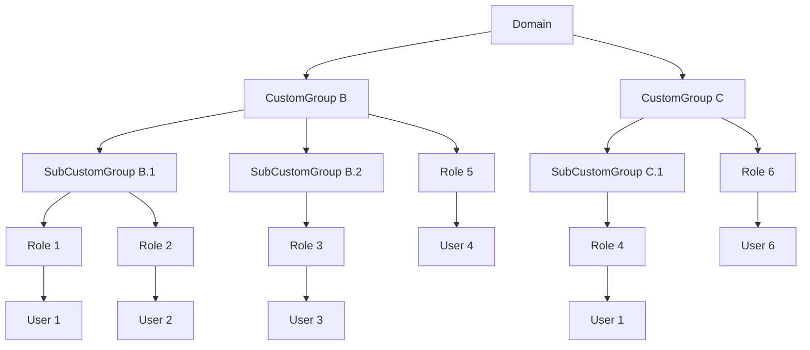
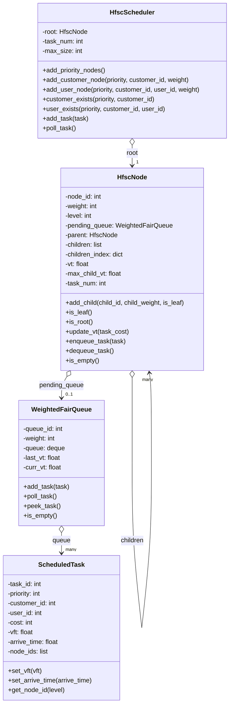
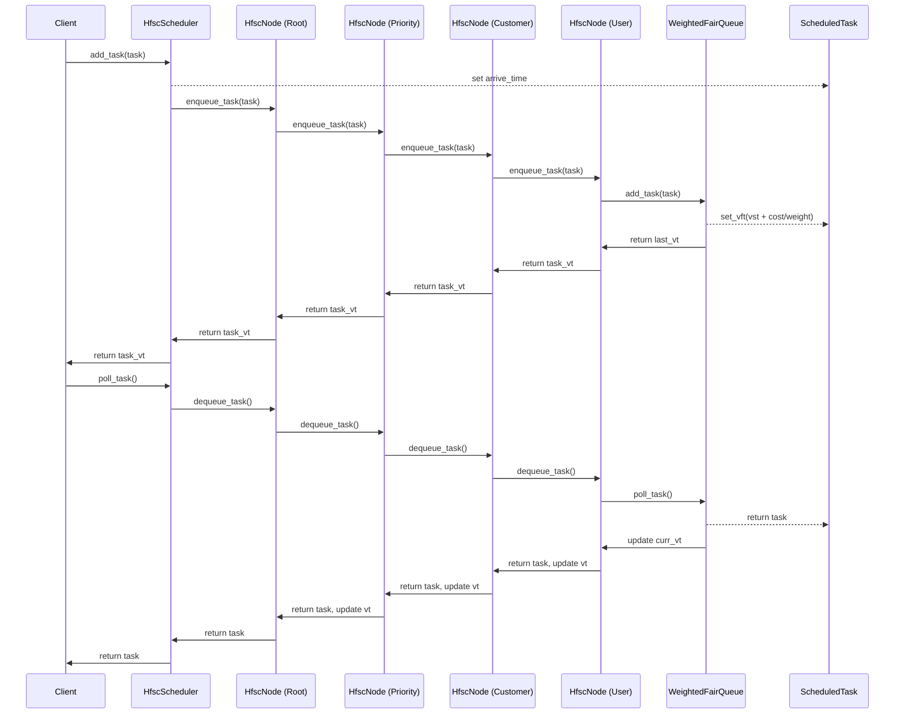
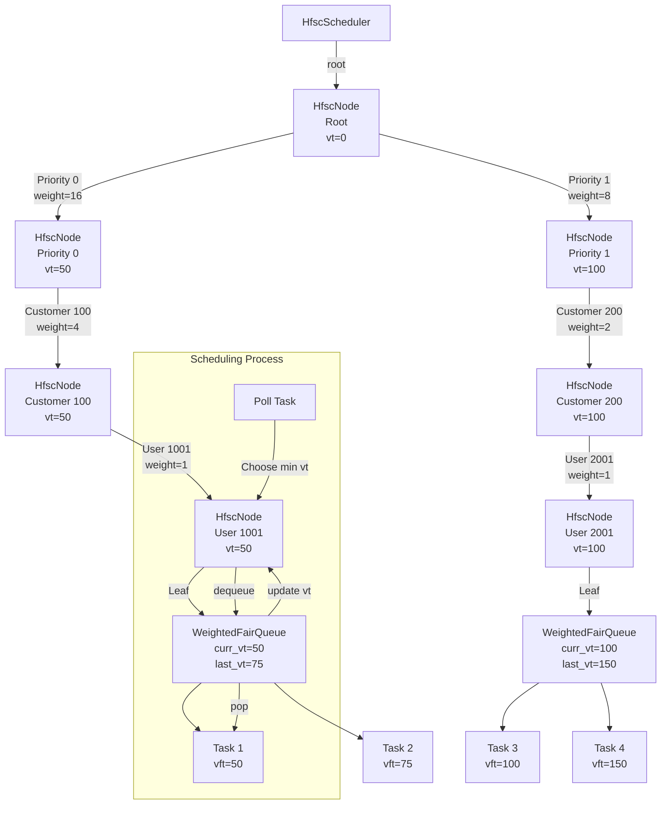
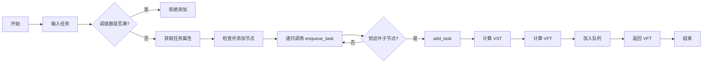
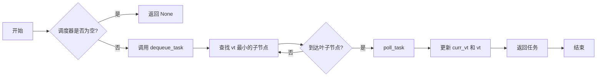

为 SaaS 服务平台提供服务的过程中，如何公平地为客户分配资源是一个关键问题。特别是在服务吞吐量存在性能瓶颈、单位时间内只能处理有限任务的情况下，如何在不同付费单位及其子用户之间实现公平的任务调度，确保一定比例的任务能够被及时处理以提升用户体验，成为一个常见的挑战。本文将探讨一种基于层次公平服务曲线（HFSC）的公平任务队列实现，分析其具体业务需求，并提出相应的解决方案。

<!-- more -->

**********

## 需求说明

我们提供的 SaaS 服务为每个付费单位分配一个“域”（CustomGroup），即一个用户组集合。域管理员可以在其中构建一个树状的用户组结构，每个用户组内可定义多个角色（Role），角色与具体用户绑定。每个用户在一个域中仅能拥有一个角色。用户可通过购买的算力创建不同优先级（低、中、高、最高）的任务，优先级越高，所需算力越多，且高优先级任务优先被处理。我们希望设计一种调度算法，确保在单位时间内为不同用户提供公平的服务，避免某些任务长时间未被处理。

域-用户组-角色-用户的结构图：



## 算法参考

### WeightedFairQueueing(WFQ)

WFQ 是一种调度算法，主要用于管理多个数据流（比如网络数据包、任务队列等），确保它们能按照一定的“公平性”和“权重”分配资源。它是 Fair Queueing（公平队列）的升级版，增加了“权重”这个概念。
想象一下，你在管理一个自助餐厅的队伍。有的人拿了小份食物（数据量小），有的人拿了大份（数据量大），还有人愿意多付钱要求优先服务（权重高）。WFQ 的目标是让每个人都能按顺序拿到食物，但那些付钱多的人（高权重）会稍微优先一点，同时保证没人被完全饿着。

WFQ 的核心是通过模拟一个“理想的公平系统”来决定谁先被服务。它的基本步骤是：

+ 给每个数据流分配权重:每个数据流（比如网络连接、任务）都有一个权重值，比如 1、2、3，代表它们的重要程度或优先级。权重越高，分配到的资源（比如带宽、处理时间）越多。
+ 计算虚拟完成时间
  + 假设有个“虚拟时钟”，它记录每个数据包（或任务）在理想情况下应该被处理完的时间。
  + 这个时间不是真实时间，而是根据数据包的大小和权重算出来的。公式很简单：
    > 虚拟完成时间 = 上一个数据包的虚拟完成时间 + (数据包大小 / 权重)
    > VFT = max(arrive_time, VFT_prev) + len / weight
  + 数据量小的包，完成时间早；权重高的流，完成时间也更早。
+ 按虚拟完成时间排序:把所有数据包按它们的虚拟完成时间从小到大排好序，然后依次处理。谁的虚拟完成时间最早，谁就先被服务。
+ 循环执行:每处理完一个数据包，就更新虚拟时钟，重新计算新来的数据包的虚拟完成时间，继续排序和处理。

WFQ 在网络编程和任务调度中特别常见。以下是几个典型场景：

+ 网络路由器
  + 应用：管理不同用户的网络流量。
  + 比如，一个路由器同时处理视频流（高权重）和邮件下载（低权重）。WFQ 保证视频流更顺畅，同时邮件下载不会完全卡住。
+ 任务调度器
  + 应用：在服务器上分配 CPU 时间给不同任务。
  + 比如，一个高优先级的任务（权重高）会更快完成，低优先级的任务也能分到一点资源。
+ 消息队列  
  + 应用：在消息系统中处理不同来源的消息。
  + 比如，一个聊天应用的“VIP 用户消息”可以优先发送。

#### WeightedFairQueueing优缺点分析

+ 优点：
  + 公平性强：通过权重比例分配资源，高权重任务更快完成。
  + 实现简单：仅需维护队列和虚拟时间。
+ 缺点：单层次：无法支持优先级、客户、用户等多级调度。
+ 启发：WFQ 的虚拟时间计算适合底层任务队列，但需扩展到分层场景。

### HierarchicalFairServiceCurve(H-FSC)

HFSC 是一种更高级的调度算法，通常用于网络带宽分配或任务调度。它在 Weighted Fair Queueing (WFQ) 的基础上增加了“层次结构”和“服务曲线”的概念。简单来说，它不仅能公平分配资源，还能按照一个“树状结构”管理多个数据流，并保证每个数据流的服务质量（QoS，比如延迟、带宽）。
想象一下，你在组织一场宴会：

+ 有不同的桌子（层次），每桌有不同的人（数据流）。
+ 每桌有总的食物量（带宽），桌子之间按权重分配。
+ 每桌内部的人也要按规则分食物，而且得保证没人饿着，还得满足某些人的特殊需求（比如“VIP 必须在 5 分钟内吃到”）。

HFSC 就像一个超级聪明的服务员，能同时管好桌子之间和桌子内部的分配。

#### HFSC的核心逻辑

HFSC 的核心是通过“层次结构”和“服务曲线”来调度资源。分解一下：

##### 层次结构（Hierarchy）  

+ 数据流被组织成一个树状结构。
+ 树的根节点代表总资源（比如总带宽），子节点是不同的类别（比如视频、语音、普通数据），每个类别下又有更细的子节点（比如具体用户）。
+ 资源先按权重从根节点分配到子节点，再在子节点内部分配。

##### 服务曲线（Service Curve）

+ 每个数据流或节点都有一个“服务曲线”，简单理解就是“资源分配的时间表”。
+ 服务曲线通常分两部分：
  + 实时性曲线：短期内保证一定资源（比如前 1 秒给 50Mbps）。
  + 长期公平性曲线：长期按权重分配（比如平均 30Mbps）。

##### e/d/v参数

HFSC 用三个关键参数来决定调度顺序：

+ Eligible Time (e)：数据包“有资格”被调度的最早时间。
+ Deadline Time (d)：数据包“必须”完成的最晚时间。
+ Virtual Time (v)：系统级别的“虚拟时钟”，保证长期公平性。

调度逻辑：

1. 找出所有 e ≤ 当前时间 的数据包（有资格的）。
2. 在这些包中，优先处理 d 最小的（最紧急的）。
3. 用 v 更新全局时钟，确保公平性。

这三个参数是 HFSC 的灵魂，我们用一个例子来说明。假设：

+ 总带宽 100Mbps。
+ 数据流 A：实时速率 r1 = 80Mbps（前 1 秒），长期速率 r2 = 50Mbps。
+ 数据包大小 = 80Mb（位），到达时间 = 0 秒。

+ Eligible Time (e)
  + 表示“包什么时候可以开始竞争”。
  + 计算：e = 到达时间 + (数据包大小 / r1) = 0 + (80Mb / 80Mbps) = 1.0 秒。  
  + 意思是，这个包在 1 秒时才能被调度。
+ Deadline Time (d)
  + 表示“包必须在什么时候完成”。
  + 计算：d = e + (数据包大小 / r1) = 1.0 + (80Mb / 80Mbps) = 2.0 秒。  
  + 意思是，这个包最晚得在 2 秒内处理完。
+ Virtual Time (v)
  + 表示“公平性的时钟”。
  + 计算：v = max(当前 v_system, 当前时间) + (数据包大小 / r2) = max(0, 0) + (80Mb / 50Mbps) = 1.6 秒。  
  + 意思是，处理完后，系统虚拟时间跳到 1.6 秒。
+ 调度过程：
  + 时间 0 秒：e = 1.0 > 0，包没资格，等待。
  + 时间 1 秒：e = 1.0 ≤ 1，包有资格，d = 2.0，处理它。
  + 更新 v_system = 1.6。

##### HFSC的应用场景

HFSC 特别适合需要复杂资源管理的场景：

+ 网络 QoS：在路由器中管理带宽，保证视频会议低延迟，文件下载有平均带宽。
+ 虚拟化：在云计算中分配 CPU 或网络资源给虚拟机。
+ 任务调度：在服务器上按层级管理任务，比如部门 → 项目组 → 具体任务。

##### HFSC简单实现

+ 实现思路
  + 数据结构：
    + 用树表示层次，每个节点有权重和服务曲线。
    + 数据包记录大小、到达时间、e/d/v。
    + 用优先级队列按 d 排序。
+ 调度步骤：
  + 检查所有包，找出 e ≤ 当前时间的。
  + 按 d 排序，处理 d 最小的。
  + 更新 v_system。
+ 层次管理：
  + 从叶子节点计算 e/d/v，向上汇总资源需求。
+ 代码实现：

    ```python
    import heapq

    class Packet:
        def __init__(self, size, arrival_time):
            self.size = size
            self.arrival_time = arrival_time
            self.e = 0
            self.d = 0
            self.v = 0

    class Node:
        def __init__(self, weight, r1=None, r2=None):
            self.weight = weight
            self.r1 = r1  # 实时速率
            self.r2 = r2  # 长期速率
            self.packets = []

        def add_packet(self, size, arrival_time):
            pkt = Packet(size, arrival_time)
            if self.r1:
                pkt.e = arrival_time + (size / self.r1)
                pkt.d = pkt.e + (size / self.r1)
            else:
                pkt.e = arrival_time
                pkt.d = float('inf')
            pkt.v = max(v_system, arrival_time) + (size / self.r2)
            self.packets.append(pkt)

    v_system = 0.0  # 全局虚拟时间

    # 构建树
    video = Node(weight=70, r1=80, r2=70)
    data = Node(weight=30, r2=30)
    video.add_packet(80, 0)
    data.add_packet(30, 0)

    # 调度
    def schedule(nodes, time):
        global v_system
        eligible = []
        for node in nodes:
            for pkt in node.packets:
                if pkt.e <= time:
                    eligible.append((pkt.d, pkt))
        if eligible:
            heapq.heapify(eligible)
            d, pkt = heapq.heappop(eligible)
            print(f"时间 {time}: 处理大小={pkt.size}, e={pkt.e:.2f}, d={pkt.d:.2f}, v={pkt.v:.2f}")
            v_system = max(v_system, pkt.v)
            for node in nodes:
                if pkt in node.packets:
                    node.packets.remove(pkt)
                    break

    # 测试
    for t in [0.0, 1.0]:
        schedule([video, data], t)
    ```

+ 输出：
  + 时间 0：处理数据包（大小=30）。
  + 时间 1：处理视频包（大小=80）。

### EarliestDeadlineFirst(EDF)最先结束最先调度

EDF 是一种实时调度算法，专门用于处理有“截止时间”（deadline）要求任务的系统。它的核心思想很简单：哪个任务的截止时间最早，就先处理哪个任务。想象你在一家快递公司工作，手头有几件包裹，每件都有一个“最晚送达时间”。EDF 就像一个聪明的调度员，总是优先处理最快要过期的包裹，确保尽量不超时。

+ 实时系统：EDF 特别适合需要严格时间保证的场景，比如嵌入式设备、实时操作系统。
+ 动态优先级：不像固定优先级调度，EDF 的优先级是动态的，根据任务的截止时间实时调整。

#### EDF的核心逻辑

EDF 的调度规则可以用一句话概括：在任意时刻，选择截止时间（deadline）最早的任务执行。具体步骤如下：

+ 任务定义：
  + 每个任务有三个关键属性：
    + 到达时间（arrival time）：任务什么时候进入系统。
    + 执行时间（execution time）：任务需要多少时间完成。
    + 截止时间（deadline）：任务必须在什么时候完成。
  + 有时还会有周期性（periodic tasks），但我们先从简单情况开始。
+ 调度过程：
  + 检查所有已经到达的任务（到达时间 ≤ 当前时间）。
  + 在这些任务中，找出截止时间最早的那个。
  + 执行这个任务，直到完成或被更高优先级（截止时间更早）的任务抢占。
+ 抢占式调度：
  + EDF 通常是抢占式的（preemptive）：如果一个新任务到达，且它的截止时间比当前任务更早，当前任务会被暂停，新任务优先执行。

一个简单的例子：

+ 假设有 3 个任务：
  + 任务 A：到达时间 = 0，执行时间 = 2，截止时间 = 4。
  + 任务 B：到达时间 = 1，执行时间 = 1，截止时间 = 3。
  + 任务 C：到达时间 = 2，执行时间 = 1，截止时间 = 5。
+ 调度过程：
  + 时间 0：只有 A 到达，截止时间 = 4，开始执行 A。
  + 时间 1：A 还剩 1 单位时间，B 到达，截止时间 = 3 < A 的 4，暂停 A，执行 B。
  + 时间 2：B 完成（用了 1 单位时间），恢复 A，C 到达，但 A 的截止时间 4 < C 的 5，继续执行 A。
  + 时间 3：A 完成（总共用了 2 单位时间），执行 C。
  + 时间 4：C 完成（用了 1 单位时间）。
+ 结果：
  + 执行顺序：A（0-1）→ B（1-2）→ A（2-3）→ C（3-4）。
  + 所有任务都在截止时间前完成：A 在 3 < 4，B 在 2 < 3，C 在 4 < 5。

#### EDF的特点

+ 优点：
  + 如果任务集是“可调度的”（总负载不超过系统容量），EDF 能保证所有任务按时完成。
  + 简单直观，适合实时性要求高的场景。
+ 缺点：
  + 如果任务超载（执行时间总和超过可用时间），EDF 可能导致多个任务失败。
  + 需要实时跟踪截止时间，计算开销稍高。

EDF 在实时系统中非常常见，以下是几个典型场景：

+ 嵌入式系统
  + 应用：汽车电子中控制刹车、引擎的任务调度。
  + 比如，刹车信号（截止时间短）优先于空调调整。
+ 实时操作系统 (RTOS)
  + 应用：在 RTOS 中调度周期性任务。
  + 比如，一个传感器每秒采样一次，必须在下次采样前处理完数据。
+ 多媒体处理  
  + 应用：视频解码中保证帧按时渲染。
  + 比如，每帧必须在 33ms（30fps）内完成。

#### 实现EDF的简单思路

要实现 EDF，你需要：

+ 用一个数据结构存储任务，记录到达时间、执行时间和截止时间。
+ 用优先级队列（按截止时间排序）管理可执行任务。
+ 每次调度时，检查新到达的任务，更新优先级。

```python
import heapq
from dataclasses import dataclass

@dataclass
class Task:
    id: str
    arrival: float  # 到达时间
    exec_time: float  # 执行时间
    deadline: float  # 截止时间
    remaining: float = 0  # 剩余执行时间

# 任务列表
tasks = [
    Task("A", 0, 2, 4),
    Task("B", 1, 1, 3),
    Task("C", 2, 1, 5)
]
for t in tasks:
    t.remaining = t.exec_time

# 调度器
def edf_schedule(tasks, max_time):
    current_time = 0
    ready_queue = []  # 优先级队列，按 deadline 排序
    
    while current_time < max_time:
        # 添加到达的任务
        for task in tasks:
            if task.arrival <= current_time and task.remaining > 0 and (task.deadline, task) not in ready_queue:
                heapq.heappush(ready_queue, (task.deadline, task))
        
        if not ready_queue:
            print(f"时间 {current_time}: 空闲")
            current_time += 1
            continue
        
        # 取出截止时间最早的任务
        _, current_task = heapq.heappop(ready_queue)
        print(f"时间 {current_time}: 执行 {current_task.id}")
        
        # 执行 1 单位时间
        current_task.remaining -= 1
        current_time += 1
        
        # 如果任务没完成，放回队列
        if current_task.remaining > 0:
            heapq.heappush(ready_queue, (current_task.deadline, current_task))

# 运行
edf_schedule(tasks, 5)
```

输出结果：

```bash
时间 0: 执行 A
时间 1: 执行 B
时间 2: 执行 A
时间 3: 执行 C
时间 4: 空闲
```

### CompleteFairScheduler(CFS)

CFS 是一种任务调度算法，最早由 Ingo Molnár 设计并引入 Linux 内核（从 2.6.23 版本开始），用来替代之前的 O(1) 调度器。它的目标是让所有任务尽可能公平地分享 CPU 时间，同时保持调度的高效性和低复杂性。想象你在组织一个派对，桌上有一块大蛋糕（CPU 时间），有几个人（任务）等着分蛋糕。CFS 的原则是：每个人都能分到蛋糕，而且分得尽量平均。如果有人更“重要”（权重高），他们会多拿一点，但不会完全抢走别人的份。

+ 公平性：CFS 的核心是“时间公平”，而不是简单地轮流执行。
+ 适用性：广泛用于现代操作系统的进程调度。

#### CFS的核心逻辑

CFS 的核心思想是基于“虚拟运行时间”（vruntime），通过它来衡量和分配 CPU 时间。以下是它的基本逻辑：

+ 虚拟运行时间 (vruntime)：
  + 每个任务都有一个 vruntime，表示它“应该”获得的 CPU 时间。
  + vruntime 的增长速度与任务的权重（优先级）成反比：
    + 权重越高，vruntime 增长越慢，任务获得更多 CPU 时间。
    + 权重越低，vruntime 增长越快，任务获得较少 CPU 时间。
+ 调度原则：
  + CFS 总是选择 vruntime 最小的任务执行。
  + 为什么？因为 vruntime 小意味着这个任务“欠”了 CPU 时间，应该优先补偿。
+ 红黑树管理：
  + CFS 用红黑树（一种高效的平衡二叉搜索树）存储所有任务，按 vruntime 排序。
  + 每次调度时，从树的最左端（vruntime 最小）取出任务。
+ 时间片：
  + 任务不会一次性用完分配的时间，而是分成小块（时间片）执行。
  + 时间片长度动态调整，确保公平性和响应性。
+ 抢占式调度：
  + 如果一个新任务的 vruntime 比当前任务小，当前任务会被抢占。

一个简单的例子：

+ 假设有 3 个任务：
  + 任务 A：权重 = 1。
  + 任务 B：权重 = 2。
  + 任务 C：权重 = 3。
  + 总权重 = 1 + 2 + 3 = 6。
+ 假设 CPU 每秒分配 1 个单位时间：
  + A 应得 1/6 秒，vruntime 增长速度 = 1 / 1 = 1。
  + B 应得 2/6 秒，vruntime 增长速度 = 1 / 2 = 0.5。
  + C 应得 3/6 秒，vruntime 增长速度 = 1 / 3 ≈ 0.33。
+ 调度过程：
  + 初始：A、B、C 的 vruntime 都是 0。
  + 时间 0：选 vruntime 最小的 A（0），运行 1 单位时间，vruntime += 1 → 1。
  + 时间 1：A=1, B=0, C=0，选 B（0），运行 1 单位时间，vruntime += 0.5 → 0.5。
  + 时间 2：A=1, B=0.5, C=0，选 C（0），运行 1 单位时间，vruntime += 0.33 → 0.33。
  + 时间 3：A=1, B=0.5, C=0.33，选 C（0.33），vruntime += 0.33 → 0.66。
+ 结果：
  + 高权重任务（C）运行更多时间，低权重任务（A）运行较少，比例接近 1:2:3。

#### CFS的特点

+ 优点：
  + 公平性：长期看，所有任务按权重比例获得 CPU 时间。
  + 高效性：红黑树操作的时间复杂度是 O(log n)。
  + 灵活性：支持动态调整权重，适应不同任务需求。
+ 缺点：
  + 不适合硬实时系统（没有严格的截止时间保证）。
  + 对高负载下响应性要求高的场景可能不够理想。

CFS 主要用于操作系统内核，但它的思想也可以应用到其他场景：

+ 操作系统进程调度
  + 应用：Linux 系统中管理用户进程。
  + 比如，一个后台任务（低权重）和一个游戏（高权重）并行运行，CFS 保证游戏更流畅。
+ 虚拟机调度
  + 应用：在虚拟化环境中分配 CPU 给虚拟机。
  + 比如，一个虚拟机跑关键服务，分配更高权重。
+ 自定义任务调度
  + 应用：在服务器程序中管理线程。
  + 比如，一个 Web 服务器优先处理 VIP 用户请求。

#### 实现CFS的简单思路

要实现 CFS，你需要：

1. 用一个红黑树（或优先级队列）存储任务，按 vruntime 排序。
2. 每次调度时，取 vruntime 最小的任务。
3. 更新 vruntime，根据权重调整增长速度。

伪代码示例（Python，用堆模拟）

```python
import heapq
from dataclasses import dataclass

@dataclass
class Task:
    id: str
    weight: float  # 权重
    vruntime: float = 0  # 虚拟运行时间

# 任务列表
tasks = [
    Task("A", 1),
    Task("B", 2),
    Task("C", 3)
]

# 调度器
def cfs_schedule(tasks, total_time):
    queue = [(t.vruntime, t) for t in tasks]
    heapq.heapify(queue)
    current_time = 0
    
    while current_time < total_time:
        if not queue:
            break
        
        # 取出 vruntime 最小的任务
        vruntime, task = heapq.heappop(queue)
        print(f"时间 {current_time}: 执行 {task.id}, vruntime={vruntime:.2f}")
        
        # 运行 1 单位时间，更新 vruntime
        vruntime_increase = 1 / task.weight  # 权重越高，增长越慢
        task.vruntime = vruntime + vruntime_increase
        current_time += 1
        
        # 放回队列
        heapq.heappush(queue, (task.vruntime, task))

# 运行
cfs_schedule(tasks, 5)
```

输出：

```bash
#C（高权重）执行 2 次，B 执行 2 次，A 执行 1 次，符合权重比例。
时间 0: 执行 A, vruntime=0.00
时间 1: 执行 B, vruntime=0.00
时间 2: 执行 C, vruntime=0.00
时间 3: 执行 C, vruntime=0.33
时间 4: 执行 B, vruntime=0.50
```

### HierarchicalWeightedFairQueueing(HWFQ)

HWFQ 是一种高级调度算法，它结合了 Weighted Fair Queueing (WFQ) 的加权公平性和“层次结构”的思想。它的目标是在多个层次上公平分配资源，比如网络带宽或 CPU 时间，同时允许不同类别的数据流或任务根据权重获得不同的服务质量。

想象你在管理一个学校的食堂：

+ 有不同的年级（层次），比如高年级和低年级。
+ 每个年级有几个班（子层次），每个班的学生（数据流）需要分饭。
+ 高年级可能更重要（权重高），分到的饭多一些，但每个年级内部也要公平。
+ HWFQ 就像一个食堂管理员，先按年级分配饭量，再在每个年级内部按班公平分。
+ 层次性：资源分配像树一样，从根节点（总资源）分到子节点（类别），再到叶子节点（具体任务）。
+ 加权公平：每个节点有权重，决定它能分到多少资源。

#### HWFQ 的核心逻辑

HWFQ 的核心是通过“层次结构”和“虚拟完成时间”来调度资源。以下是它的基本步骤：

+ 树形层次结构：
  + 数据流或任务被组织成一棵树。
  + 根节点代表总资源（比如 100Mbps 带宽）。
  + 中间节点是类别（比如视频、语音），有自己的权重。
  + 叶子节点是具体的数据流或任务，也有权重。
  + 资源先按权重从根分配到中间节点，再到叶子节点。
+ 虚拟完成时间 (Virtual Finish Time)：
  + 每个数据包或任务计算一个“虚拟完成时间”，表示它在理想情况下应该完成的时间。
  + 计算公式（简化版）：
    > 虚拟完成时间 = 上一个包的完成时间 + (数据包大小 / 权重对应的速率)。
  + 权重越高，速率越大，虚拟完成时间越早。
+ 调度过程：
  + 从树的叶子节点开始，计算每个数据包的虚拟完成时间。
  + 每个中间节点从它的子节点中选择虚拟完成时间最早的包，向上汇总。
  + 根节点最终选择全局虚拟完成时间最早的包执行。
+ 公平性保证：
  + 每个层次的节点按权重分配资源。
  + 叶子节点内的数据流也按权重公平分享父节点的资源。

一个简单的例子

+ 假设总带宽是 100Mbps，树结构如下：
  + 根节点：100Mbps。
  + 视频类（权重 70%，70Mbps）：
    + V1（权重 1），V2（权重 2）。
  + 数据类（权重 30%，30Mbps）：
    + D1（权重 1）。
+ 数据包：
  + V1：100Mb，V2：100Mb，D1：100Mb。
+ 计算虚拟完成时间：假设起始时间为 0：
  + V1：带宽 = 70 * (1 / (1+2)) ≈ 23.33Mbps，虚拟完成时间 = 100 / 23.33 ≈ 4.29 秒。
  + V2：带宽 = 70 * (2 / (1+2)) ≈ 46.67Mbps，虚拟完成时间 = 100 / 46.67 ≈ 2.14 秒。
  + D1：带宽 = 30 * (1 / 1) = 30Mbps，虚拟完成时间 = 100 / 30 ≈ 3.33 秒。
+ 调度顺序：
  + V2（2.14） → D1（3.33） → V1（4.29）。
  + V2（高权重）最先完成，D1 次之，V1 最后。

#### HWFQ的特点

+ 优点：
  + 层次公平：既保证大类别间的公平，又保证类别内部的公平。
  + 灵活性：支持复杂的资源分配需求。
  + 可预测性：通过虚拟完成时间提供延迟保证。
+ 缺点：
  + 复杂性：需要维护树结构和计算虚拟时间，复杂度高于简单 WFQ。
  + 实时性有限：不像 EDF 那样严格按截止时间调度。

HWFQ 适用于需要层次化资源管理的场景：

+ 网络带宽管理
  + 应用：在路由器中分配带宽给不同部门或用户组。
  + 比如，公司网络中研发部门（高权重）优先，行政部门次之。
+ 云计算资源分配
  + 应用：在虚拟化环境中分配 CPU 或网络资源。
  + 比如，一个租户有多个虚拟机，按权重分配资源。
+ 任务调度
  + 应用：在服务器上管理多级任务。
  + 比如，一个项目组有多个子任务，按重要性分配处理时间。

#### 实现HWFQ的简单思路

要实现 HWFQ，你需要：

+ 用树结构表示层次，每个节点有权重和子节点。
+ 为每个数据包计算虚拟完成时间。
+ 用优先级队列在每个节点选择最早完成的包。

伪代码示例（Python）

```python
import heapq

class Packet:
    def __init__(self, size, flow_id):
        self.size = size
        self.flow_id = flow_id
        self.vft = 0  # 虚拟完成时间

class Node:
    def __init__(self, weight, bandwidth):
        self.weight = weight
        self.bandwidth = bandwidth
        self.children = []
        self.packets = []

    def add_packet(self, size, flow_id):
        pkt = Packet(size, flow_id)
        self.packets.append(pkt)

    def calc_vft(self, pkt, parent_bandwidth):
        rate = parent_bandwidth * (self.weight / sum(c.weight for c in self.children or [self]))
        pkt.vft = (pkt.size / rate) if self.children else (pkt.size / self.bandwidth)

# 构建树
root = Node(weight=100, bandwidth=100)
video = Node(weight=70, bandwidth=70)
data = Node(weight=30, bandwidth=30)
v1 = Node(weight=1, bandwidth=0)
v2 = Node(weight=2, bandwidth=0)
d1 = Node(weight=1, bandwidth=0)
root.children = [video, data]
video.children = [v1, v2]
data.children = [d1]

# 添加数据包
v1.add_packet(100, "V1")
v2.add_packet(100, "V2")
d1.add_packet(100, "D1")

# 调度
def schedule(root):
    queue = []
    def process_node(node, parent_bandwidth):
        if node.packets:
            for pkt in node.packets:
                node.calc_vft(pkt, parent_bandwidth)
                heapq.heappush(queue, (pkt.vft, pkt))
        for child in node.children:
            process_node(child, node.bandwidth)

    process_node(root, root.bandwidth)
    while queue:
        vft, pkt = heapq.heappop(queue)
        print(f"调度 {pkt.flow_id}, 虚拟完成时间={vft:.2f}")

schedule(root)
```

输出：

```bash
调度 V2, 虚拟完成时间=2.14
调度 D1, 虚拟完成时间=3.33
调度 V1, 虚拟完成时间=4.29
```

## WFQ 与 H-FSC 结合的动机

+ 需求分析：
  + 层次性：业务需要按优先级、客户和用户分级调度。
  + 公平性：资源分配需根据权重比例，避免饿死。
  + 简洁性：实现不能过于复杂，便于维护。
+ WFQ 的局限：
  + 单层次设计无法直接满足需求，但其虚拟时间计算（VFT）简单高效，是公平调度的核心。
+ H-FSC 的优势：
  + 分层结构天然支持多级调度，虚拟时间管理与 WFQ 兼容。
  + 服务曲线虽强大，但对非实时任务（如批量处理）并非必需。
+ 结合动机：
  + 用 H-FSC 的树形结构解决层次问题。
  + 用 WFQ 的虚拟时间计算作为叶子节点的调度基础，简化 H-FSC 的复杂状态。

### 结合点

+ 层次结构（H-FSC）：
  + 采用 H-FSC 的树形设计：Root -> Priority -> Customer -> User。
  + 每个节点维护 vt，用于调度选择。
+ 底层队列（WFQ）：
  + 叶子节点使用 WeightedFairQueue，直接应用 WFQ 的 VFT 计算。
  + 任务的 vft 驱动队列的 curr_vt，进而影响节点的 vt。
+ 调度逻辑：
  + 从根节点递归选择 vt 最小的叶子节点（H-FSC 风格）。
  + 叶子节点按 FIFO 弹出任务，更新 vt（WFQ 风格）。

### 取舍与优化

+ 保留：
  + WFQ 的 VFT 计算：简单高效，核心公平性保证。
  + H-FSC 的层次选择：支持多级权重。
+ 简化：
  + 移除 H-FSC 的 e 和 d：减少计算开销，适用于非实时场景。
  + 不采用红黑树：线性遍历子节点，牺牲部分性能换取简洁性。
+ 权衡：
  + 性能：O(n) 遍历适合中小规模，放弃 O(log n) 的复杂数据结构。
  + 实时性：无服务曲线支持，专注公平性而非硬时限。

### 实现步骤

+ 任务添加：
  + 从 HfscScheduler 递归找到叶子节点（H-FSC）。
  + 在 WeightedFairQueue 中计算 vft 并入队（WFQ）。
+ 任务移除：
  + 遍历树选择 vt 最小的叶子节点（H-FSC）。
  + 从队列弹出任务并更新 vt（WFQ）。
+ 虚拟时间同步：
  + 叶子节点的 vt 与 WeightedFairQueue 的 curr_vt 同步。
  + 中间节点的 vt 根据子节点更新，保留 H-FSC 的层次协调。

### 方案考虑点与优缺点

考虑点:

+ 分层需求：树形结构支持多级权重。
+ 公平性：虚拟时间避免饿死。
+ 性能：O(n) 遍历，适合中小规模。
+ 扩展性：动态添加节点。

优点:

+ 层次公平：多级权重分配。
+ 实现简单：结合 WFQ 简洁性，简化 H-FSC。
+ 灵活性：权重可调。

缺点:

+ 性能瓶颈：大规模节点效率低。
+ 简化局限：无实时性支持。
+ 单线程假设：需额外并发控制。

## 算法的python实现

### 类图

+ HfscScheduler 包含一个 root（HfscNode）。
+ HfscNode 可以有多个子节点（children），叶子节点拥有一个 WeightedFairQueue。
+ WeightedFairQueue 包含多个 ScheduledTask。



### 代码实现

#### scheduled_task.py

```python
class ScheduledTask:
    def __init__(self, task_id, priority, customer_id, user_id, cost=1000, customer_weight=1, user_weight=1):
        self.task_id = task_id
        self.priority = priority
        self.customer_id = customer_id
        self.user_id = user_id
        self.cost = cost
        self.customer_weight = customer_weight
        self.user_weight = user_weight
        self.vft = 0
        self.arrive_time = 0
        self.node_ids = [priority, customer_id, user_id]

    def set_vft(self, vft):
        self.vft = vft

    def set_arrive_time(self, arrive_time):
        self.arrive_time = arrive_time

    def get_node_id(self, level):
        return self.node_ids[level] if level < len(self.node_ids) else -1
```

#### weighted_fair_queue.py

```python
from collections import deque

class WeightedFairQueue:
    def __init__(self, queue_id, weight):
        self.queue_id = queue_id
        self.weight = weight
        self.queue = deque()
        self.last_vt = 0
        self.curr_vt = 0

    def add_task(self, task):
        arrive_time = task.arrive_time
        vir_start = max(arrive_time, self.last_vt)
        task.set_vft(vir_start + task.cost / self.weight)
        self.last_vt = task.vft
        if not self.queue:
            self.curr_vt = self.last_vt
        self.queue.append(task)

    def poll_task(self):
        if not self.queue:
            return None
        task = self.queue.popleft()
        if self.queue:
            self.curr_vt = self.queue[0].vft
        else:
            self.curr_vt = float('inf')
        return task

    def peek_task(self):
        return self.queue[0] if self.queue else None

    def is_empty(self):
        return len(self.queue) == 0
```

#### hfsc_node.py

```python
class HfscNode:
    def __init__(self, node_id, weight, level):
        self.node_id = node_id
        self.weight = weight
        self.level = level
        self.pending_queue = None
        self.parent = None
        self.children = []
        self.children_index = {}
        self.vt = 0
        self.max_child_vt = 0
        self.task_num = 0

    def add_child(self, child_id, child_weight, is_leaf):
        child = HfscNode(child_id, child_weight, self.level + 1)
        if is_leaf:
            child.pending_queue = WeightedFairQueue(child_id, child_weight)
        child.parent = self
        self.children.append(child)
        self.children_index[child_id] = child

    def is_leaf(self):
        return self.pending_queue is not None

    def is_root(self):
        return self.parent is None

    def update_vt(self, task_cost):
        if not self.is_root():
            self.vt += task_cost / self.weight

    def enqueue_task(self, task):
        self.task_num += 1
        if self.is_leaf():
            self.pending_queue.add_task(task)
            self.vt = self.pending_queue.curr_vt
            return self.pending_queue.last_vt
        else:
            child_id = task.get_node_id(self.level)
            child = self.children_index[child_id]
            task_vt = child.enqueue_task(task)
            return task_vt

    def dequeue_task(self):
        self.task_num -= 1
        if self.is_leaf():
            task = self.pending_queue.poll_task()
            self.vt = self.pending_queue.curr_vt
            return task
        else:
            min_vt = float('inf')
            chosen_child = None
            for node in self.children:
                if node.vt < min_vt and not node.is_empty():
                    min_vt = node.vt
                    chosen_child = node
            if not chosen_child:
                return None
            task = chosen_child.dequeue_task()
            if chosen_child.vt > self.max_child_vt:
                self.max_child_vt = chosen_child.vt
            self.update_vt(task.cost)
            return task

    def is_empty(self):
        return self.task_num == 0
```

#### hfsc_scheduler.py

```python
class HfscScheduler:
    def __init__(self, max_size=10000):
        self.root = HfscNode(0, 0, 0)
        self.task_num = 0
        self.max_size = max_size
        self.add_priority_nodes()

    def add_priority_nodes(self):
        for i in range(5):
            self.root.add_child(i, 2 ** (4 - i), False)

    def add_customer_node(self, priority, customer_id, weight):
        self.root.children_index[priority].add_child(customer_id, weight, False)

    def add_user_node(self, priority, customer_id, user_id, weight):
        customer_node = self.root.children_index[priority].children_index[customer_id]
        customer_node.add_child(user_id, weight, True)

    def customer_exists(self, priority, customer_id):
        return customer_id in self.root.children_index[priority].children_index

    def user_exists(self, priority, customer_id, user_id):
        if not self.customer_exists(priority, customer_id):
            return False
        return user_id in self.root.children_index[priority].children_index[customer_id].children_index

    def add_task(self, task):
        if self.task_num >= self.max_size:
            return -1
        self.task_num += 1
        priority = min(task.priority, 4)
        task.node_ids[0] = priority
        customer_id = task.customer_id
        user_id = task.user_id
        if not self.customer_exists(priority, customer_id):
            self.add_customer_node(priority, customer_id, max(task.customer_weight, 1))
        if not self.user_exists(priority, customer_id, user_id):
            self.add_user_node(priority, customer_id, user_id, max(task.user_weight, 1))
        return self.root.enqueue_task(task)

    def poll_task(self):
        if self.task_num == 0:
            return None
        self.task_num -= 1
        return self.root.dequeue_task()
```

### 调用时序图



### 公平任务队列的层次调度示意图



### 任务添加流程



### 任务移除流程



## Reference

+ [Weighted_fair_queueing](1.https://en.wikipedia.org/wiki/Weighted_fair_queueing)
+ [Earliest_deadline_first_scheduling](https://en.wikipedia.org/wiki/Earliest_deadline_first_scheduling)
+ [Completely_Fair_Scheduler](https://en.wikipedia.org/wiki/Completely_Fair_Scheduler)