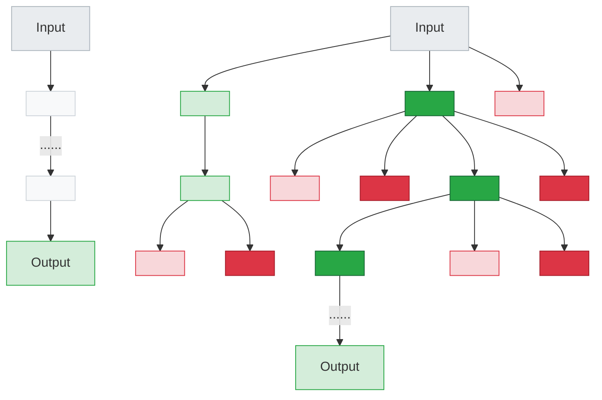

谷歌近日发布了一份长达 68 页的白皮书，系统阐述了提示工程（Prompt Engineering）的核心理念与最佳实践。这份白皮书原版是英文，为了方便自己学习理解，我将其翻译成中文（利用各种LLM工具），并整理出这篇文章，分享给需要的人。需要注意的是，我是基于[Google官方提示工程原版网站](https://www.kaggle.com/whitepaper-prompt-engineering)提供的v7版本[pdf](https://github.com/lewlh/share/blob/main/documents/PromptEngineeringV7.pdf)进行翻译。本译文已经生成PDF,读者朋友们也可以直接下载[PromptEngineering中文翻译.pdf](https://github.com/lewlh/share/blob/main/documents/PromptEngineering%E4%B8%AD%E6%96%87%E7%BF%BB%E8%AF%91.pdf)


<!-- more -->

**********

> 你不需要成为数据科学家或机器学习工程师 - 每个人都可以编写提示。

## 导言

在考虑大型语言模型的输入和输出时，文本提示（有时伴随着其他模态，如图像提示）是模型用来预测特定输出的输入。你不需要成为数据科学家或机器学习工程师 - 每个人都可以编写提示。然而，编写最有效的提示可能很复杂。提示的许多方面都会影响其效果：你使用的模型、模型的训练数据、模型配置、你的措辞、风格和语气、结构以及上下文都很重要。因此，提示工程是一个迭代过程。不充分的提示可能导致模糊、不准确的响应，并可能阻碍模型提供有意义的输出。

当你与 [Gemini](https://gemini.google.com) 聊天机器人聊天时，你基本上是在编写提示，但是本文档侧重于在 Vertex Al 内或通过 API 为 Gemini 模型编写提示，因为通过直接提示模型，你将可以访问 temperature 等配置。

本白皮书详细讨论了提示工程。我们将研究各种提示技术，以帮助你入门，并分享提示专家的技巧和最佳实践。我们还将讨论你在编写提示时可能面临的一些挑战。

## 提示工程

记住 LLM 的工作原理；它是一个预测引擎。模型将连续文本作为输入，然后根据其训练的数据预测下一个 token 应该是什么。LLM 通过重复执行此操作来实现操作化，将先前预测的 token 添加到连续文本的末尾，以预测下一个 token。下一个 token 预测基于先前 token 中的内容与 LLM 在其训练过程中看到的内容之间的关系。

当你编写提示时，你试图设置 LLM 以预测正确的 token 序列。提示工程是设计高质量提示的过程，这些提示指导 LLM 生成准确的输出。此过程涉及调整以找到最佳提示，优化提示长度，以及评估与任务相关的提示的写作风格和结构。在自然语言处理和 LLM 的上下文中，提示是提供给模型的输入，以生成响应或预测。

这些提示可用于实现各种理解和生成任务，例如文本摘要、信息提取、问答、文本分类、语言或代码翻译、代码生成和代码文档或推理。

请随时参考 Google 的提示指南 [2](https://inthecloud.withgoogle.com/gemini-for-google-workspace-prompt-guide/dl-cd.html).[3](https://cloud.google.com/vertex-ai/generative-ai/docs/learn/prompts/introduction-prompt-design)，其中包含简单有效的提示示例。

在进行提示工程时，你将首先选择一个模型。无论你是在 Vertex AI 中使用 Gemini 语言模型、GPT、Claude 还是像 Gemma 或 LLaMΑ 这样的开源模型，都可能需要针对你的特定模型优化提示。

除了提示之外，你还需要调整 LLM 的各种配置。

## LLM输出配置

选择模型后，你需要确定模型配置。大多数 LLM 都带有各种控制 LLM 输出的配置选项。有效的提示工程需要为你的任务优化设置这些配置。

### 输出长度

一个重要的配置设置是响应中要生成的 token 数量。生成更多 token 需要 LLM 进行更多计算，从而导致更高的能源消耗、可能更慢的响应时间和更高的成本。

减少 LLM 的输出长度不会导致 LLM 在其创建的输出中在文体或文本上更加简洁，而只会导致 LLM 在达到限制后停止预测更多 token。如果你的需求需要较短的输出长度，你可能还需要调整提示以适应。

对于某些 LLM 提示技术（如 ReAct）来说，限制输出长度尤为重要，因为 LLM 会在你想要的响应之后继续发出无用的 token。

请注意，生成更多 token 需要 LLM 进行更多计算，从而导致更高的能源消耗和可能更慢的响应时间，进而导致更高的成本。

### 采样控制

LLM 并不正式地预测单个 token。相反，LLM 预测下一个 token 可能是什么的概率，LLM 词汇表中的每个 token 都有一个概率。然后对这些 token 概率进行采样，以确定下一个生成的 token 将是什么。Temperature、top-K 和 top-P 是最常见的配置设置，它们决定如何处理预测的 token 概率以选择单个输出 token。

#### Temperature

Temperature 控制 token 选择中的随机程度。较低的 temperature 适用于需要更确定性响应的提示，而较高的 temperature 可能导致更多样化或意外的结果。 0 的 temperature（贪婪解码）是确定性的：始终选择概率最高的 token（但请注意，如果两个 token 具有相同的最高预测概率，则根据平局决胜的实现方式，你可能不会总是获得相同的 temperature 为 0 的输出）。

接近最大值的 temperature 往往会产生更随机的输出。并且随着 temperature 越来越高，所有 token 成为下一个预测 token 的可能性均等。

Gemini temperature 控制的理解方式与机器学习中使用的 softmax 函数类似。低 temperature 设置类似于低 softmax temperature (T)，强调具有高确定性的单个首选 temperature 。较高的 Gemini temperature 设置类似于较高的 softmax temperature，使所选设置周围的更广泛的 temperature 范围更可接受。这种增加的不确定性适应了不需要严格精确 temperature 的场景，例如在试验创造性输出时。

#### Top-K和top-P

Top-K 和 top-P[（也称为 nucleus sampling）](https://cloud.google.com/vertex-ai/docs/generative-ai/model-reference/text#request_body)是 LLM 中使用的两种采样设置，用于将预测的下一个 token 限制为来自具有最高预测概率的 token。与 temperature 一样，这些采样设置控制生成文本的随机性和多样性。

+ **Top-K** 采样从模型的预测分布中选择前 K 个最可能的 token。top-K 越高，模型的输出就越有创造性和多样性；top-K 越低，模型的输出就越受限制和基于事实。Top-K 为 1 相当于贪婪解码。
+ **Top-P** 采样选择累积概率不超过某个值 (P) 的 top token。P 的值范围从 0（贪婪解码）到 1（LLM 词汇表中的所有 token）。

在 top-K 和 top-P 之间进行选择的最佳方法是同时试验这两种方法（或两者一起），看看哪种方法产生你想要的结果。

#### 综合应用

在 top-K、top-P、temperature 和要生成的 token 数量之间进行选择，取决于具体的应用和期望的结果，并且这些设置都会相互影响。重要的是，要确保你了解你选择的模型如何将不同的采样设置组合在一起。

如果 temperature、top-K 和 top-P 均可用（如在 Vertex Studio 中），则满足 top-K 和 top-P 标准的 token 是下一个预测 token 的候选 token，然后应用 temperature 从通过 top-K 和 top-P 标准的 token 中进行采样。如果只有 top-K 或 top-P 可用，则行为相同，但仅使用一个 top-K 或 P 设置。

如果 temperature 不可用，则从满足 top-K 和/或 top-P 标准的任何 token 中随机选择，以生成单个下一个预测 token。

在一个采样配置值的极端设置下，该采样设置要么取消其他配置设置，要么变得无关紧要。

+ 如果将 temperature 设置为 0，则 top-K 和 top-P 变得无关紧要——最可能的 token 成为下一个预测的 token。如果将 temperature 设置得非常高（高于 1——通常为 10 左右），则 temperature 变得无关紧要，并且无论哪些 token 通过 top-K 和/或 top-P 标准，都会随机采样这些 token 以选择下一个预测的 token。
+ 如果将 top-K 设置为 1，则 temperature 和 top-P 变得无关紧要。只有一个 token 通过 top-K 标准，该 token 是下一个预测的 token。如果将 top-K 设置得非常高，例如设置为 LLM 词汇表的大小，则任何具有非零概率成为下一个 token 的 token 都将满足 top-K 标准，并且不会排除任何 token。
+ 如果将 top-P 设置为 0（或一个非常小的值），大多数 LLM 采样实现将仅考虑最可能的 token 以满足 top-P 标准，从而使 temperature 和 top-K 变得无关紧要。如果将 top-P 设置为 1，则任何具有非零概率成为下一个 token 的 token 都将满足 top-P 标准，并且不会排除任何 token。

作为一个通用的起点， temperature 为 0.2，top-P 为 0.95，top-K 为 30 将为你提供相对连贯的结果，这些结果可能具有创造性，但不会过于极端。如果你想要特别有创造性的结果，请尝试从 temperature 为 0.9，top-P 为 0.99，top-K 为 40 开始。如果你想要不太有创造性的结果，请尝试从 temperature 为 0.1，top-P 为 0.9，top-K 为 20 开始。最后，如果你的任务始终只有一个正确答案（例如，回答一个数学问题），请从 temperature 为 0 开始。

**注意：** 随着自由度的增加（更高的 temperature、top-K、top-P 和输出 token），LLM 可能会生成相关性较低的文本。

**警告：** 你是否见过以大量填充词结尾的回复？这也称为“重复循环错误”，这是大型语言模型中常见的问题，即模型陷入循环，重复生成相同的（填充）词、短语或句子结构，通常因不适当的 temperature 和 top-k/op-p 设置而加剧。这可能发生在低 temperature 和高 temperature 设置下，尽管原因是不同的。在低 temperature 下，模型变得过于确定性，严格遵循最高概率路径，如果该路径重新访问先前生成的文本，则可能导致循环。相反，在高 temperature 下，模型的输出变得过于随机，增加了随机选择的词或短语偶然导致回到先前状态的概率，从而由于大量可用选项而产生循环。在这两种情况下，模型的采样过程都会“卡住”，导致单调且无益的输出，直到输出窗口被填满。解决这个问题通常需要仔细调整 temperature 和 top-k/top-p 值，以找到确定性和随机性之间的最佳平衡。

## 提示工程技巧

LLM 经过调整以遵循指令，并在大量数据上进行训练，因此它们可以理解提示并生成答案。但是 LLM 并不完美；你的提示文本越清晰，LLM 就越能更好地预测下一个可能的文本。此外，利用 LLM 的训练方式和 LLM 的工作原理的特定技巧将帮助你从 LLM 获得相关的结果。

既然我们已经了解了什么是提示工程以及它需要什么，那么让我们深入研究一些最重要的提示技巧的示例。

### 通用提示/零样本

[零样本](https://arxiv.org/pdf/2109.01652.pdf)提示是最简单的提示类型。它只提供任务的描述和一些文本，供 LLM 开始处理。这个输入可以是任何内容：一个问题、一个故事的开头或指令。“零样本”这个名称代表“没有示例”。

让我们使用 [Vertex AI](https://cloud.google.com/model-garden>) 中的 Vertex AI Studio（用于语言），它提供了一个测试提示的平台。在表 1 中，你将看到一个用于分类电影评论的零样本提示示例。如下使用的表格格式是记录提示的好方法。你的提示很可能在最终进入代码库之前经历多次迭代，因此以一种有条理、结构化的方式跟踪你的提示工程工作非常重要。关于这种表格格式、跟踪提示工程工作的重要性以及提示开发过程的更多信息，请参阅本章后面的“最佳实践”部分（“记录各种提示尝试”）。

模型温度应设置为较低的数字，因为不需要创造力，我们使用 gemini-pro 的默认 top-K 和 top-P 值，这实际上禁用了这两个设置（参见上面的“LLM 输出配置”）。请注意生成的输出。“令人不安”和“杰作”这两个词应该使预测稍微复杂一些，因为这两个词都用在同一个句子中。

| Feature      | Value|
|:------------:|---------|
| Name         | 1_1_movie_classification|
| Goal         | Classify movie reviews as positive, neutral or negative. |
| Model        | gemini-pro  |
| Temperature  | 0.1         |
| Token Limit  | 5           |
| Top-K        | N/A         |
| Top-P        | 1           |
| Prompt       | Classify movie reviews as POSITIVE, NEUTRAL or NEGATIVE. Review: "Her" is a disturbing study revealing the direction humanity is headed if AI is allowed to keep evolving, unchecked. I wish there were more movies like this masterpiece. Sentiment: |
| Output       | POSITIVE    |

表格1. 一个零样本提示词的样例

当零样本不起作用时，你可以在提示中提供演示或示例，这将引出“一次性”和“少样本”提示。

### 单样本提示&少样本提示

在为 AI 模型创建提示时，提供示例很有帮助。这些示例可以帮助模型理解你的要求。当你想要引导模型输出特定的结构或模式时，示例尤其有用。

单样本提示提供单个示例，因此得名一次性。这个想法是模型有一个可以模仿的示例，以最好地完成任务。

[少样本提示](https://arxiv.org/pdf/2005.14165.pdf)向模型提供多个示例。这种方法向模型展示了它需要遵循的模式。这个想法与一次性类似，但是所需模式的多个示例增加了模型遵循该模式的机会。

少样本提示所需的示例数量取决于几个因素，包括任务的复杂性、示例的质量以及你使用的生成式 AI (gen AI) 模型的能力。作为一般经验法则，你应该为少样本提示使用至少三到五个示例。但是，对于更复杂的任务，你可能需要使用更多示例，或者由于模型的输入长度限制，你可能需要使用更少的示例。

表格 2 显示了一个少样本提示示例，让我们使用与之前相同的 gemini-pro 模型配置设置，除了增加 token 限制以适应更长响应的需求。

| Goal         | Parse pizza orders to JSON|
|:------------:|---------|
| Model        | gemini-pro  |
| Temperature  | 0.1         |
| Token Limit  | 250           |
| Top-K        | N/A         |
| Top-P        | 1           |
| Prompt       | Parse a customer's pizza order into valid JSON:<br><br>EXAMPLE:<br>I want a small pizza with cheese, tomato sauce, and pepperoni.<br>JSON Response:<br>{<br>"size": "small",<br>"type": "normal",<br>"ingredients": \[["cheese", "tomato sauce","peperoni"]]<br>}<br><br>EXAMPLE:<br>Can I get a large pizza with tomato sauce, basil and mozzarella<br>JSON Response:<br>{<br>"size": "large",<br>"type": "normal",<br>"ingredients": \[["tomato sauce", "bazel","mozzarella"]]<br>}<br><br>Now, I would like a large pizza, with the first half cheese and mozzarella. And the other tomato sauce, ham and pineapple.<br>JSON Response:|
| Output | <br>{<br>"size": "large",<br>"type": "half-half",<br>"ingredients": \[["cheese", "mozzarella"],["tomato sauce","ham", "pineapple"]]<br>}<br> |

表格2. 一个少样本提示词的样例

当你为提示选择示例时，请使用与你想要执行的任务相关的示例。这些示例应该是多样化的、高质量的和写得好的。一个小错误可能会使模型感到困惑，并导致不希望的输出。

如果你试图生成对各种输入都具有鲁棒性的输出，那么在你的示例中包含边缘情况非常重要。边缘情况是指不寻常或意外的输入，但模型仍然应该能够处理。

### 系统、上下文和角色提示

系统、上下文和角色提示都是用于指导 LLM 生成文本的技术，但它们侧重于不同的方面：

+ 系统提示为语言模型设置了整体上下文和目的。 它定义了模型应该做什么的“大局”，例如翻译语言、分类评论等。
+ 上下文提示提供与当前对话或任务相关的特定细节或背景信息。 它帮助模型理解所提问的细微差别，并相应地调整响应。
+ 角色提示为语言模型分配要采用的特定角色或身份。 这有助于模型生成与其分配的角色及其相关的知识和行为一致的响应。

系统、上下文和角色提示之间可能存在相当大的重叠。例如，为系统分配角色的提示也可以具有上下文。

但是，每种类型的提示都有略微不同的主要目的：

+ 系统提示：定义模型的基本能力和总体目标。
+ 上下文提示：提供立即的、特定于任务的信息以指导响应。 它高度特定于当前任务或输入，这是动态的。
+ 角色提示：构建模型的输出风格和声音。 它增加了一层特异性和个性。

区分系统、上下文和角色提示提供了一个设计具有明确意图的提示的框架，允许灵活的组合，并使分析每种提示类型如何影响语言模型的输出变得更加容易。

让我们深入研究这三种不同类型的提示。

#### 系统提示

表格 3 包含一个系统提示，我在其中指定了有关如何返回输出的附加信息。 我增加了temperature 以获得更高的创造力水平，并指定了更高的 token 限制。 但是，由于我对如何返回输出有明确的指示，模型没有返回额外的文本。

| Feature      | Value|
|:------------:|---------|
| Goal         | Classify movie reviews as positive, neutral or negative. |
| Model        | gemini-pro  |
| Temperature  | 1           |
| Token Limit  | 5           |
| Top-K        | 40          |
| Top-P        | 0.8         |
| Prompt       | Classify movie reviews as positive, neutral or negative. Only return the label in uppercase. Review: "Her" is a disturbing study revealing the direction humanity is headed if AI is allowed to keep evolving, unchecked. It's so disturbing I couldn't watch it. Sentiment: |
| Output       | NEGATIVE    |

表格3. 一个系统提示的样例

系统提示可用于生成满足特定要求的输出。 “系统提示”这个名称实际上代表“向系统提供额外的任务”。例如，你可以使用系统提示来生成与特定编程语言兼容的代码片段，或者你可以使用系统提示来返回某种结构。  请查看表 4，我在其中以 JSON 格式返回输出。

| Goal         | Classify movie reviews as positive, neutral or negative, return JSON.|
|:------------:|---------|
| Model        | gemini-pro  |
| Temperature  | 1           |
| Token Limit  | 1024        |
| Top-K        | 40          |
| Top-P        | 0.8         |
| Prompt       | Classify movie reviews as positive, neutral or negative. Return valid JSON: <br>Review: "Her" is a disturbing study revealing the direction humanity is headed if AI is allowed to keep evolving, unchecked. It's so disturbing I couldn't watch it.<br>Schema:<br>\```<br>MOVIE:<br>{<br>"sentiment": String "POSITIVE" \| "NEGATIVE" \| "NEUTRAL",<br>"name": String<br>}<br>MOVIE REVIEWS:<br>{<br>"movie_reviews": [MOVIE]<br>}<br>```<br>JSON Response:|
|Output|\```<br>{<br>"movie_reviews": [<br>{<br>"sentiment": "NEGATIVE",<br>"name": "Her"<br>}<br>]<br>}<br>```|

表格4. 一个定义了json格式输出系统提示的样例

从提取数据的提示返回 JSON 对象有一些好处。  在实际应用中，我不需要手动创建这种 JSON 格式，我可以按排序后的顺序返回数据（在处理日期时间对象时非常方便），但最重要的是，通过提示 JSON 格式，它迫使模型创建结构并限制幻觉。

系统提示对于安全性和毒性也非常有用。要控制输出，只需在提示中添加一行，例如：“你的回答应该有礼貌。”。

#### 角色提示

角色提示是提示工程中的一种技术，它涉及为 gen AI 模型分配一个特定的角色。  这可以帮助模型生成更相关和信息丰富的输出，因为模型可以根据分配给它的特定角色来设计其响应。

例如，你可以角色提示 gen AI 模型担任图书编辑、幼儿园老师或励志演说家的角色。一旦模型被分配了一个角色，你就可以为其提供特定于该角色的提示。例如，你可以提示一位老师创建一个他们可以审阅的课程计划。请查看表格 5，其中模型扮演的是旅行指南的角色。

| Goal         | Act as travel guide and provide 3 travel suggestions|
|:------------:|---------|
| Model        | gemini-pro  |
| Temperature  | 1           |
| Token Limit  | 1024        |
| Top-K        | 40          |
| Top-P        | 0.8         |
| Prompt       | I want you to act as a travel guide. I will write to you about my location and you will suggest 3 places to visit near me. In some cases, I will also give you the type of places I will visit.<br>My suggestion: "I am in Amsterdam and I want to visit only museums."<br>Travel Suggestions:|
|Output|1. Rijksmuseum: World-renowned museum, known for Dutch masterpieces like Rembrandt’s “The Night Watch.” Don’t miss the incredible collection of paintings and artifacts showcasing Dutch art and history.<br>2. Van Gogh Museum: Immerse yourself in the captivating works of Vincent van Gogh. The museum houses the largest collection of his paintings and drawings, including “The Starry Night” and “Sunflowers.”<br>3. Stedelijk Museum Amsterdam: Discover modern and contemporary art from around the world. The museum’s collection includes works by Picasso, Kandinsky, and Rietveld, housed in a striking modern building.|

表格5. 一个角色提示的样例

上例展示了扮演旅行社代理角色的一个示例。当你将角色更改为地理老师时，你会注意到你将收到不同的回复。

为 AI 模型定义角色视角，可以为其提供你正在寻找的语气、风格和专注专业知识的蓝图，以提高输出的质量、相关性和有效性。

以下是一些我认为有效的风格，你可以从中选择：

对抗性的、描述性的、直接的、正式的、幽默的、有影响力的、非正式的、鼓舞人心的、有说服力的

让我们在表格 6 中更改提示，以包含幽默和鼓舞人心的风格。

| Goal         | Act as travel guide and provide 3 travel suggestions|
|--------------|---------|
| Prompt       | I want you to act as a travel guide. I will write to you about my location and you will suggest 3 places to visit near me  in a humorous style.<br>My suggestion: "I am in Manhattan."<br>Travel Suggestions:|
|Output|1. Behold the Empire State of Mind: Ascend to the dizzying heights of the Empire State Building and bask in the glory of Manhattan's skyline. Prepare to feel like King Kong atop the Big Apple, minus the giant ape-sized banana.<br>2. Get Artsy-Fartsy at MoMA: Unleash your inner art aficionado at the Museum of Modern Art (MoMA). Gaze upon masterpieces that will boggle your mind and make you question whether your stick-figure drawings have anyartistic merit.<br>3. Shop ‘Til You Drop on Fifth Avenue: Indulge in some retail therapy on the iconic Fifth Avenue. Brace yourself for sticker shock as you window-shop (or actually shop) at designer boutiques that will make your wallet cry. But hey,you’re in Manhattan, so you might as well embrace the fabulousness!|

表格6. 一个幽默语气和风格的角色提示示例

#### 上下文提示

通过提供上下文提示，你可以帮助确保你的人工智能互动尽可能地无缝和高效。正如你在表格 7 的示例中看到的那样，模型将能够更快地理解你的请求，并能够生成更准确和相关的响应。

| Goal         | Suggest articles for a blog about retro games |
|:------------:|---------|
| Model        | gemini-pro  |
| Temperature  | 1           |
| Token Limit  | 1024        |
| Top-K        | 40          |
| Top-P        | 0.8         |
| Prompt       | Context: You are writing for a blog about retro 80's arcade video games.<br>Suggest 3 topics to write an article about with a few lines of description of what this article should contain.|
|Output|1. **The Evolution of Arcade Cabinet Design:**<br>This article would explore the evolution of arcade cabinet designs, from the early wood and metal cabinets of the 1970s to the sleek, neon-lit designs of the 1980s and beyond.<br>2. **Blast From The Past: Iconic Arcade Games of The 80’s:**<br> - This article would feature a glimpse into the history, impact, and legacy of some of the most iconic and influential arcade games of the 1980s, highlighting their innovations, popular mechanics, and enduring charm.<br>3. **The Rise and Retro Revival of Pixel Art:**<br>- This article would delve into the evolution of pixel art as a defining visual style of early arcade games, tracing its roots, exploring its techniques, and discussing the resurgence of pixel art in modern games and digital art.|

表格7. 一个上下文提示示例

### 退后提示

[退后提示](https://openreview.net/pdf?id=3bq3jsvcQ1.)是一种通过提示 LLM 首先考虑与手头特定任务相关的更一般性问题，然后将该一般性问题的答案输入到后续的特定任务提示中，从而提高性能的技术。 这种“退后”使 LLM 能够在尝试解决特定问题之前激活相关的背景知识和推理过程。

通过考虑更广泛和潜在的原则，LLM 可以生成更准确和更有洞察力的响应。 退后提示鼓励 LLM 进行批判性思考，并以新的和创造性的方式应用他们的知识。 它通过利用 LLM 参数中比直接提示 LLM 时更多的知识来更改执行任务的最终提示。

通过关注一般原则而不是具体细节，退后提示可以帮助减轻 LLM 响应中的偏差。

让我们看一下这些示例，以了解退后提示如何改善结果。 在我们将传统提示（表格 8）与退后提示（表格 9）进行比较之前，我们先回顾一下传统提示：

| Goal         | Write a storyline for a level of a first-person shooter video game. |
|:------------:|---------|
| Model        | gemini-pro  |
| Temperature  | 1           |
| Token Limit  | 1024        |
| Top-K        | 40          |
| Top-P        | 0.8         |
| Prompt       | Write a one paragraph storyline for a new level of a first-person shooter video game that is challenging and engaging.|
|Output|The level begins with the player’s squad being ambushed in a dense urban area by a relentless enemy faction. Players must fight their way through a maze of back alleys and dilapidated buildings, utilizing stealth and precision to eliminate enemy forces and avoid detection. The player must use their environment to their advantage, setting traps, utilizing cover, and making calculated moves to survive. Along the way, they uncover intel suggesting the enemy is planning a devastating attack, and the player must race against time to gather evidence and relay it back to their headquarters before the enemy can carry out their plans.|

表格8. 与退后提示进行比较之前的传统提示

当你将温度设置为 1 时，你可能会得到各种各样的故事情节创意，但它也相当随机和通用。  所以，让我们退一步：

| Goal         | Write a storyline for a level of a first-person shooter video game.|
|:------------:|---------|
| Prompt       | Based on popular first-person shooter action games, what are 5 fictional key settings that contribute to a challenging and engaging level storyline in a first-person shooter video game?|
| Output       |1. **Abandoned Military Base**: A sprawling, post-apocalyptic military complex crawling with mutated soldiers and rogue robots, ideal for challenging firearm combat.<br>2. **Cyberpunk City**: A neon-lit, futuristic urban environment with towering skyscrapers and dense alleyways, featuring cybernetically enhanced enemies and hacking mechanics.<br>3. **Alien Spaceship**: A vast alien vessel stranded on Earth, with eerie corridors, zero-gravity sections, and extraterrestrial creatures to encounter.<br>4. **Zombie-Infested Town**: A desolate town overrun by hordes of aggressive zombies, featuring intense close-quarters combat and puzzle-solving to find safe passage.<br>5. **Underwater Research Facility**: A deep-sea laboratory flooded with water,filled with mutated aquatic creatures, and requiring stealth and underwater exploration skills to survive.|

表格9. 自我一致性提示的示例

是的，这些主题似乎非常适合第一人称视频游戏。  让我们回到最初的提示，但这次我们将退后一步的答案作为上下文，看看它会返回什么。

| Goal         | Write a storyline for a level of a first-person shooter video game.|
|:------------:|---------|
| Prompt       |Context: 5 engaging themes for a first person shooter video game:<br>1. **Abandoned Military Base**: A sprawling, post-apocalyptic military complex crawling with mutated soldiers and rogue robots, ideal for challenging firearm combat.<br>2. **Cyberpunk City**: A neon-lit, futuristic urban environment with towering skyscrapers and dense alleyways, featuring cybernetically enhanced enemies and hacking mechanics.<br>3. **Alien Spaceship**: A vast alien vessel stranded on Earth, with eerie corridors, zero-gravity sections, and extraterrestrial creatures to encounter.<br>4. **Zombie-Infested Town**: A desolate town overrun by hordes of aggressive zombies, featuring intense close-quarters combat and puzzle-solving to find safe passage.<br>5. **Underwater Research Facility**: A deep-sea laboratory flooded with water, filled with mutated aquatic creatures, and requiring stealth and underwater exploration skills to survive. Take one of the themes and write a one paragraph storyline for a new level of a first-person shooter video game that is challenging and engaging.|
| Output       |In the heart of a murky abyss, lies a dilapidated underwater research facility, standing as a testament to human ambition and its disastrous consequences. Shrouded in darkness, pulsating with the hum of malfunctioning machinery, and haunted by the echoes of drowned souls, the facility is now a breeding ground for a nightmare borne from the deep sea. The player, an elite marine equipped with advanced diving gear and experimental weaponry, is tasked with venturing into this aquatic realm of terror. Armed with resilience and resourcefulness, they must navigate treacherous corridors, solve cryptic puzzles, and confront gruesome sea monstrosities that lurk in the depths. From grappling with the crushing pressure of the deep sea to outsmarting cunning aquatic predators, every moment in this uncharted underworld tests the limits of human endurance and courage.|

表格10. 自我一致性提示的示例

这看起来像是一个有趣的视频游戏！  通过使用退后提示技术，你可以提高提示的准确性。

### 思维链(Chain of Thought, CoT)

[思维链 (CoT)](https://arxiv.org/pdf/2201.11903.pdf) 提示是一种通过生成**中间推理步骤**来提高 LLM 的推理能力的技术。 这有助于 LLM 生成更准确的答案。 你可以将其与少样本提示结合使用，以在需要推理才能响应的更复杂任务上获得更好的结果，因为这是零样本思维链的一个挑战。

CoT 有很多优点。 首先，它在非常有效的同时也很省力，并且可以与现成的 LLM 很好地配合使用（因此无需进行微调）。 你还可以通过 CoT 提示获得可解释性，因为你可以从 LLM 的响应中学习并查看所遵循的推理步骤。 如果出现故障，你将能够识别它。 思维链似乎可以提高在不同 LLM 版本之间移动时的鲁棒性。 这意味着你的提示在不同 LLM 之间的性能差异应该比你的提示不使用推理链时更小。 当然，也有缺点，但它们有些直观。

LLM 响应包括思维链推理，这意味着更多的输出 token，这意味着预测成本更高并且需要更长的时间。

为了解释表 11 中的以下示例，让我们首先尝试创建一个不使用 CoT 提示的提示，以展示大型语言模型的缺陷。

|              | |
|:------------:|---------|
| Prompt       |When I was 3 years old, my partner was 3 times my age. Now, I am 20 years old. How old is my partner?|
| Output       |63 years old|

表格11. 尝试解决数学问题的提示示例

哎呀。 这显然是错误的答案。 事实上，LLM 通常在数学任务中表现不佳，并且可能会提供不正确的答案——即使是像两个数字相乘这样简单的任务。 这是因为它们是在大量文本上训练的，而数学可能需要不同的方法。 因此，让我们看看中间推理步骤是否会改善输出。

|              | |
|:------------:|---------|
| Prompt       |When I was 3 years old, my partner was 3 times my age. Now, I am 20 years old. How old is my partner? Let's think step by step.|
| Output       |1. Let’s assume my current age is “x” years.<br>2. When I was 3 years old, my age was 3 years.<br>3. My partner’s age at that time was 3 times my age, which means my partner’s age was 3 * 3 = 9 years.<br>4. Now, I am 20 years old, which means my age has increased by 20 - 3 = 17 years since I was 3 years old.<br>5. Since my partner’s age was 9 years when I was 3 years old, and my age has increased by 17 years, my partner’s age must have also increased by 17 years.<br>6. Therefore, my partner’s current age is 9 + 17 = 26 years.<br>So, my partner is 26 years old.|

表格12. 思维链提示的示例

好的，现在的最终答案是正确的。 这是因为我们清楚地指示 LLM 解释每个步骤，而不是只返回一个答案。 有趣的是，模型加起来了增加的 17 年。 在我看来，我会计算出我和我伴侣之间的年龄差，然后把它们加起来。 (20+(9-3))。 让我们帮助模型更像我一样思考。

表格12 是“零样本”思维链的一个示例。 当与单样本或少样本结合使用时，思维链提示可能非常强大，如你在表 13 中所见：

|              | |
|:------------:|---------|
| Prompt       |Q: When my brother was 2 years old, I was double his age. Now I am 40 years old. How old is my brother? Let's think step by step.<br>A: When my brother was 2 years, I was 2 * 2 = 4 years old.That's an age difference of 2 years and I am older. Now I am 40 years old, so my brother is 40 - 2 = 38 years old. The answer is 38.<br>Q: When I was 3 years old, my partner was 3 times my age. Now,I am 20 years old. How old is my partner? Let's think step by step.<br>A:|
| Output       |When I was 3 years old, my partner was 3 * 3 = 9 years old. That’s an age difference of 6 years and my partner is older. Now I am 20 years old, so my partner is 20 + 6 = 26 years old. The answer is 26.|

表格13. 带有单样本的思维链提示示例

思维链可用于各种用例。 考虑代码生成，将请求分解为几个步骤，并将这些步骤映射到特定的代码行。 或者，当你有某种种子时创建合成数据，例如“产品称为 XYZ，编写一个描述，引导模型完成你根据给定标题所做的假设。” 通常，任何可以通过“讨论”来解决的任务都是思维链的良好候选者。 如果你可以解释解决问题的步骤，请尝试思维链。

请参阅 GoogleCloudPlatform Github 存储库中托管的 [notebook](https://github.com/GoogleCloudPlatform/generative-ai/blob/main/language/prompts/examples/chain_of_thought_react.ipynb)，其中将详细介绍 CoT 提示：

在本章的最佳实践部分，我们将学习一些特定于思维链提示的最佳实践。

### 自洽性

虽然大型语言模型在各种 NLP 任务中都表现出了令人瞩目的成功，但它们的推理能力通常被认为是一个仅靠增加模型大小无法克服的局限性。 正如我们在前面的“思维链”提示部分所了解到的，可以提示模型生成像人类解决问题一样的推理步骤。 然而，CoT 使用简单的“贪婪解码”策略，限制了其有效性。[自洽性](https://arxiv.org/pdf/2203.11171.pdf)结合了采样和多数投票，以生成不同的推理路径并选择最一致的答案。 它提高了 LLM 生成的响应的准确性和连贯性。 自洽性给出了答案正确的伪概率可能性，但显然成本很高。

它遵循以下步骤：

1. 生成不同的推理路径：多次向 LLM 提供相同的提示。 高温设置鼓励模型生成关于问题的不同推理路径和视角。
2. 从每个生成的响应中提取答案。
3. 选择最常见的答案。

让我们看一个电子邮件分类系统的示例，该系统将电子邮件分类为“重要”或“不重要”。 零样本思维链提示将多次发送给 LLM，以查看每次提交后的响应是否不同。 请注意电子邮件中使用的友好语气、措辞和讽刺。 所有这些都可能会迷惑 LLM。

|              | |
|:------------:|---------|
| Prompt       |EMAIL:<br>\```<br>Hi,<br>I have seen you use Wordpress for your website. A great open source content management system. I have used it in the past too. It comes with lots of great user plugins. And it's pretty easy to set up.<br>I did notice a bug in the contact form, which happens when you select the name field. See the attached screenshot of me entering text in the name field. Notice the JavaScript alert box that I inv0k3d.<br>But for the rest it's a great website. I enjoy reading it. Feel free to leave the bug in the website, because it gives me more interesting things to read.<br>Cheers,<br>Harry the Hacker.<br>```<br>Classify the above email as IMPORTANT or NOT IMPORTANT. Let's think step by step and explain why. |
| Output Attempt 1|**Step 1: Identify the purpose of the email.**<br>The purpose of the email is to inform the recipient of a bug in the contact form on their website. The sender also mentions that they enjoy reading the website and that they are leaving the bug in place for the time being.<br>**Step 2: Assess the potential impact of the bug.**<br>The bug in the contact form could allow an attacker to execute arbitrary JavaScript code on the website. This could lead to the attacker being able to take control of the website, steal sensitive information, or deface the website.<br>**Step 3: Consider the credibility of the sender.**<br>The sender of the email claims to be a hacker named Harry. However, there is no way to verify the sender’s identity. It is possible that the sender is a legitimate hacker who is trying to help the recipient, but it is also possible that the sender is a malicious actor who is trying to trick the recipient into clicking on a malicious link or downloading a malicious file.<br>**Conclusion: IMPORTANT**<br>Based on the potential impact of the bug and the credibility of the sender,the email should be classified as **IMPORTANT**. The recipient should take immediate action to fix the bug and protect their website from attack.|
| Output Attempt 2|**Explanation:**<br>1. **Lack of urgency:** The email does not convey any sense of urgency or time-sensitivity. It starts with a casual greeting and presents the information in a matter-of-fact tone.<br>2. **Non-critical bug report:** The bug reported in the contact form is described as interesting but not critical. The email sender even suggests that the website owner can leave the bug in place.<br>3. **Lack of personal impact:** The email does not indicate any direct or personal impact on the website owner. It simply mentions that the sender enjoys reading the website.<br>4. **Absence of action request:** The email does not explicitly request any action from the website owner. It does not ask for the bug to be fixed or provide any specific suggestions for improvement.<br>5. **Sender’s intent:** The sender’s intention seems to be more focused on sharing an observation and expressing interest in the website rather than raising a serious concern or requesting assistance.<br>**Conclusion: NOT IMPORTANT**|
| Output Attempt 3|**Step 1: Identify the purpose of the email.**<br>The purpose of the email is to inform the recipient of a bug in the contact form on their website. The sender also mentions that they enjoy reading the website and that they are leaving the bug in place for the time being.<br>**Step 2: Assess the potential impact of the bug.** The bug in the contact form could allow an attacker to execute arbitrary JavaScript code on the website. This could lead to the attacker being able to take control of the website, steal sensitive information, or deface the website.<br>**Step 3: Consider the credibility of the sender.** The sender of the email claims to be a hacker named Harry. However, there is no way to verify the sender’s identity. It is possible that the sender is a legitimate hacker who is trying to help the recipient, but it is also possible that the sender is a malicious actor who is trying to exploit the bug for their own gain.<br>**Conclusion:**<br>Based on the above factors, the email should be classified as **IMPORTANT**. The bug in the contact form is a serious security risk, and the sender’s credibility is unknown. The recipient should take immediate action to fix the bug and|

表格14. 自洽性提示的示例

你可以使用上面的提示，并尝试看看它是否返回一致的分类。 根据你使用的模型和温度配置，它可能会返回“重要”或“不重要”。

通过生成许多思维链，并采用最常出现的答案（“重要”），我们可以从 LLM 获得更一致的正确答案。

此示例展示了如何通过考虑多个视角并选择最一致的答案，使用自洽性提示来提高 LLM 响应的准确性。

### 思维树 (Tree of Thoughts, ToT)

既然我们已经熟悉了思维链和自洽性提示，让我们来回顾一下思维树 (ToT)。它概括了 CoT 提示的概念，因为它允许 LLM 同时探索多个不同的推理路径，而不仅仅是遵循单一的线性思维链。如图 1 所示。



Figure 1.  思维链提示（左图）与思维树提示（右图）的可视化比较

这种方法使 ToT 特别适合需要探索的复杂任务。它的工作原理是维护一个思维树，其中每个思维代表一个连贯的语言序列，作为解决问题的中间步骤。然后，模型可以通过从树中的不同节点分支出来探索不同的推理路径。

有一个很棒的 notebook，它更详细地介绍了基于论文[“大型语言模型引导的思维树”的思维树 (ToT)](https://arxiv.org/pdf/2201.11903.pdf)。

### ReAct（推理 & 行动)

推理和行动 (ReAct)[10](https://arxiv.org/pdf/2210.03629.pdf) 提示是一种范例，它使 LLM 能够使用自然语言推理结合外部工具（搜索、代码解释器等）来解决复杂的任务，从而允许 LLM 执行某些操作，例如与外部 API 交互以检索信息，这是迈向智能代理建模的第一步。

ReAct 模仿了人类在现实世界中的运作方式，因为我们进行语言推理并可以采取行动来获取信息。在各种领域中，ReAct 的性能优于其他提示工程方法。

ReAct 提示通过将推理和行动组合成一个“思考-行动”循环来工作。LLM 首先推断问题并生成行动计划。然后，它执行计划中的操作并观察结果。然后，LLM 使用观察结果更新其推理并生成新的行动计划。这个过程一直持续到 LLM 找到问题的解决方案。

要了解它的实际应用，你需要编写一些代码。在代码片段 1 中，我将 Python 的 langchain 框架与 VertexAI (google-cloud-aiplatform) 和 google-search-results pip 软件包结合使用。

要运行此示例，你必须从 <https://serpapi.com/manage-api-key> 创建一个（免费的）SerpAPI 密钥，并设置一个环境变量 SERPAPI_API_KEY。

接下来，让我们编写一些 Python 代码，任务是让 LLM 计算出：Metallica 乐队中一位著名父亲有多少个孩子。

```python
from langchain.agents import load_tools
from langchain.agents import initialize_agent
from langchain.agents import AgentType
from langchain.llms import VertexAI
prompt = "How many kids do the band members of Metallica have?"
llm = VertexAI(temperature=0.1)
tools = load_tools(["serpapi"], llm=llm)
agent = initialize_agent(tools, llm,
agent=AgentType.ZERO_SHOT_REACT_DESCRIPTION, verbose=True)
agent.run(prompt)
```

代码片段1. 使用 LangChain 和 VertexAI 创建 ReAct 代理

代码片段 2 显示了结果。 请注意，ReAct 进行了五次搜索。 实际上，LLM 正在抓取 Google 搜索结果以找出乐队名称。 然后，它将结果列为观察结果，并串联思考以进行下一次搜索。

```bash
> Entering new AgentExecutor chain...
Metallica has 4 members.
Action: Search
Action Input: How many kids does James Hetfield have?
Observation: three children
Thought: 1/4 Metallica band members have 3 children
Action: Search
Action Input: How many kids does Lars Ulrich have?
Observation: 3
Thought: 2/4 Metallica band members have 6 children
Action: Search
Action Input: How many kids does Kirk Hammett have?
Observation: Hammett has been married to his second wife Lani since 1998.
They have two sons, Angel (b. September 29, 2006) and Vincenzo (b. June
28, 2008).
Thought: 3/4 Metallica band members have 8 children
Action: Search
Action Input: How many kids does Robert Trujillo have?
Observation: 2
Thought: 4/4 Metallica band members have 10 children
Final Answer: 10
```

代码片段2. 在终端中执行 ReAct 代理

代码片段 2 计算出 Metallica 乐队有四名成员。 然后，它搜索每个乐队成员以请求孩子的总数并计算总数。 最后，它返回孩子的总数作为最终答案。

ReAct 提示在实践中需要理解你需要不断地重新发送先前的提示/响应（并修剪掉额外的生成内容），以及使用适当的示例/指令设置模型。 请参阅 GoogleCloudPlatform Github 存储库中托管的 [notebook](https://github.com/GoogleCloudPlatform/applied-ai-engineering-samples/blob/main/genai-on-vertex-ai/advanced_prompting_training/cot_react.ipyn)，其中更详细地展示了带有更详细示例的实际 LLM 输入和输出。

### 自动提示工程

在这一点上，你可能会意识到编写提示可能很复杂。如果能够自动化这个过程（编写一个提示来编写提示）岂不是很好？好吧，有一种方法：自动提示工程 (APE)。[这种方法](https://arxiv.org/pdf/2211.01910.pdf>)不仅减轻了人工输入的需要，还提高了模型在各种任务中的性能。

你将提示一个模型来生成更多提示。 评估它们，可能修改好的提示。然后重复这个过程。

例如，你可以使用自动提示工程来帮助训练商品 T 恤网店的聊天机器人。我们想要弄清楚客户可以用哪些不同的方式来表达他们购买乐队商品 T 恤的订单。

1. 编写将生成输出变体的提示。 在此示例中，我使用 gemini-pro 生成 10 条指令。 请参阅表 15：
2. 通过根据选择的指标对候选提示进行评分来评估所有候选指令。 例如，你可以使用 BLEU（双语评估辅助）或 ROUGE（基于召回率的要点评估）。
3. 选择具有最高评估分数的候选指令。 此候选指令将成为你可以在软件应用程序或聊天机器人中使用的最终提示。 你还可以调整选择的提示并再次评估。

|              | |
|:------------:|---------|
| Prompt       |We have a band merchandise t-shirt webshop, and to train a chatbot we need various ways to order: "One Metallica t-shirt size S". Generate 10 variants, with the same semantics but keep the same meaning.|
|Output|1. I’d like to purchase a Metallica t-shirt in size small.<br>2. Can I order a small-sized Metallica t-shirt?<br>3. I’d like to buy one Metallica t-shirt in small.<br>4. One Metallica shirt, size small, please.<br>5. I want one Metallica t-shirt in size small.<br>6. I’d like to place an order for one Metallica t-shirt in small.<br>7. Small Metallica t-shirt, one please.<br>8. I’m looking for one Metallica t-shirt in small.<br>9. Can you get me one Metallica t-shirt in small?<br>10. One Metallica small t-shirt, please.|

表格15. 使用 LLM 生成提示

### 代码提示

Gemini 主要关注基于文本的提示，其中也包括用于返回代码的编写提示。让我们转到 Vertex AI Studio 并测试这些提示，以查看一些编码示例。

#### 用于编写代码的提示

Gemini 也可以成为一名开发人员，并帮助你使用你选择的任何编程语言编写代码。作为一名开发人员，这可以帮助你加快编写代码的速度。

想象一下你的机器上有一个包含数百个文件的文件夹，需要重命名。重命名每个文件会花费你大量时间。你懂一点 Bash，可以编写一个脚本来自动化这个过程，但也可能需要一段时间。 因此，让我们编写一个提示。你可以在公共消费者聊天机器人 Gemini 中编写提示，或者如果你更关心机密性，你可以在你的 Google Cloud 帐户中打开 Vertex AI Studio 来编写这些提示。Vertex AI Studio 的优势在于你可以配置 temperature 等。

| Feature      | Value|
|:------------:|---------|
| Name         | 1_bash_rename_files_in_folder |
| Goal         | Write a prompt to write code in Bash to rename files in a folder. |
| Model        | gemini-pro  |
| Temperature  | 0.1         |
| Token Limit  | 1024        |
| Top-K        | N/A         |
| Top-P        | 1           |
| Prompt       | rite a code snippet in Bash, which asks for a folder name. Then it takes the contents of the folder and renames all the files inside by prepending the name draft to the file name.|
| Output       | |

```bash
#!/bin/bash
# Ask for the folder name
echo "Enter the folder name: "
read folder_name
# Check if the folder exists
if [ ! -d "$folder_name" ]; then
echo "Folder does not exist."
exit 1
fi
# Get the list of files in the folder
files=( "$folder_name"/* )
# Rename each file by prepending "draft" to the file name
for file in "${files[@]}"; do
new_file_name="draft_$(basename "$file")"
mv "$file" "$new_file_name"
done
echo "Files renamed successfully."
```

表格16. 使用 Gemini 编写代码

在我看来，这似乎是很好的代码——甚至还有文档！但是，由于 LLM 无法进行推理，并且会重复训练数据，因此首先阅读和测试你的代码至关重要。

我们都在等待的时刻，它真的有效吗？

让我们首先在一个仅包含少量文件的测试文件夹中尝试一下，这些文件需要从 filename.txt 重命名为 draft_filename.txt。

+ 从表格 16 复制输出（不包括 bash 文本包装器），并将其粘贴到一个名为：“rename_files.sh”的新文件中。
+ 打开一个终端窗口，然后键入：. rename_files.sh。 它将要求输入一个文件夹名称，例如 test，然后按 Enter 键。
+ 脚本似乎运行良好。 你将看到消息：文件已成功重命名。 当你查看测试文件夹时，请注意所有文件都已完美地重命名为 draft_filename.txt。

它奏效了！

#### 用于解释代码的提示

当你作为一名开发人员在团队中工作时，你必须阅读别人的代码。 Gemini 也可以在这方面为你提供帮助。 让我们以表格 16 中的代码输出为例，删除注释，并要求大型语言模型解释发生了什么，请参阅表格 17：

| Feature      | Value|
|:------------:|---------|
| Name         | 1_bash_explain_the_code |
| Goal         | Write a prompt to explain Bash code |
| Model        | gemini-pro  |
| Temperature  | 0.1         |
| Token Limit  | 1024        |
| Top-K        | N/A         |
| Top-P        | 1           |
| Prompt       | Explain to me the below Bash code: |
| Output       | This Bash script performs the following tasks:<br>1. **User Input**:<br>- It prompts the user to enter a folder name using the `echo` and `read` commands. The entered folder name is stored in the `folder_name` variable.<br>2. **Folder Existence Check**:<br>- It checks if the folder with the specified name exists using the `[ ! -d “$folder_name” ]` condition. If the folder does not exist, it displays an error message (“Folder does not exist.”) and exits the script with an exit code of 1. <br> 3. **File Listing**:<br>- It lists all the files inside the specified folder using the `files=( “$folder_name”/* )` command. This creates an array called `files` containing the paths to all the files in the folder.<br>4. **File Renaming**:<br>- It iterates through each file in the `files` array using a `for` loop.<br>- For each file, it generates a new file name using the `new_file_name=”draft_$(basename “$file”)” ` command. This new file name is created by prefixing the original file name with the string “draft_”.<br>- It then renames the file using the `mv “$file” “$new_file_name”` command, which moves the file to the new file name.<br>5. **Success Message**:<br>- After renaming all the files, it displays a success message (“Files renamed successfully.”) to indicate that the renaming operation was successful|

```bash
####################################
# Explain to me the below Bash code:
####################################

#!/bin/bash
echo "Enter the folder name: "
read folder_name
if [ ! -d "$folder_name" ]; then
echo "Folder does not exist."
exit 1
fi
files=( "$folder_name"/* )
for file in "${files[@]}"; do
new_file_name="draft_$(basename "$file")"
mv "$file" "$new_file_name"
done
echo "Files renamed successfully."
```

表格17. 用于解释代码的提示

#### 编程语言转换的提示

表格 16 中的 bash 代码似乎运行良好。 但是，如果这个脚本可以提示我输入文件名，那么它将真正具有可重用性，理想情况下，它应该作为一个带有 UI 的独立应用程序运行。从起点来看，Python 对于（Web）应用程序来说是一种比 Bash 更好的语言。LLM 可以帮助将代码从一种语言翻译成另一种语言。请参阅表 18 中的示例：

| Feature      | Value|
|:------------:|---------|
| Name         | 1_python_rename_files |
| Goal         | Write a prompt to translate Bash code to Python|
| Model        | gemini-pro  |
| Temperature  | 0.1         |
| Token Limit  | 1024        |
| Top-K        | N/A         |
| Top-P        | 1           |
| Prompt       | Translate the below Bash code to a Python snippet. |
| Output       | |

+ Prompt

    ```bash
    #####################################################
    # Translate the below Bash code to a Python snippet.
    #####################################################

    #!/bin/bash
    echo "Enter the folder name: "
    read folder_name
    if [ ! -d "$folder_name" ]; then
    echo "Folder does not exist."
    exit 1
    fi
    files=( "$folder_name"/* )
    for file in "${files[@]}"; do
    new_file_name="draft_$(basename "$file")"
    mv "$file" "$new_file_name"
    done
    echo "Files renamed successfully."
    ```

+ Output

    ```python
    import os
    import shutil
    # Get the folder name from the user
    folder_name = input("Enter the folder name: ")
    # Check if the folder exists
    if not os.path.isdir(folder_name):
    print("Folder does not exist.")
    exit(1)
    # Get a list of all files in the folder
    files = os.listdir(folder_name)
    # Iterate over the files
    for file in files:
    # Create a new file name with the prefix "draft_"
    new_file_name = f"draft_{file}"
    # Move the file to the new name
    shutil.move(os.path.join(folder_name, file),
    os.path.join(folder_name, new_file_name))
    # Print a success message
    print("Files renamed successfully.")
    ```

表格 18. 一个将代码从 Bash 翻译为 Python 的提示

阅读并检查代码。 从提示中复制输出并将其粘贴到一个新文件中：file_renamer.py。 通过打开一个终端窗口并执行以下命令来测试代码：python file_renamer.py。

注意：当在 Vertex AI 的 Language Studio 中提示（Python）代码时，你必须单击“Markdown”按钮。 否则，你将收到缺少正确行缩进的纯文本，这对于运行 Python 代码非常重要。

#### 用于调试和审查代码的提示

让我们手动对表 18 中的代码进行一些编辑。它应该提示用户输入文件名前缀，并将此前缀以大写字符写入。请参阅代码片段 *3 中的示例代码，但真糟糕。它现在返回 Python 错误！

```python
import os
import shutil
folder_name = input("Enter the folder name: ")
prefix = input("Enter the string to prepend to the filename: ")
text = toUpperCase(prefix)
if not os.path.isdir(folder_name):
print("Folder does not exist.")
exit(1)
files = os.listdir(folder_name)
for file in files:
new_filename = f"{text}_{file}"
shutil.move(os.path.join(folder_name, file),
os.path.joi(folder_name, new_file_name))
print("Files renamed successfully.")
```

代码片段 3. 一个损坏的 Python 脚本

哎呀！这看起来像是一个 bug：

```bash
The below Python code gives an error:
Traceback (most recent call last):
File “/Users/leeboonstra/Documents/test_folder/rename_files.py”, line 7,
in <module>
text = toUpperCase(prefix)
NameError: name ‘toUpperCase’ is not defined
```

代码片段 4. 我破坏了 Python 代码

让我们看看是否可以要求大型语言模型调试和审查代码。请查看表格 19：

| Feature      | Value|
|:------------:|---------|
| Name         | 1_python_debug_code |
| Goal         | Write a prompt to debug and review Python code.|
| Model        | gemini-pro  |
| Temperature  | 0.1         |
| Token Limit  | 1024        |
| Top-K        | N/A         |
| Top-P        | 1           |
| Prompt       | The below Python code gives an error:<br>Traceback (most recent call last):<br>File "/Users/leeboonstra/Documents/test_folder/rename_files.py", line 7, in <module> <br> text = toUpperCase(prefix)<br>NameError: name 'toUpperCase' is not defined<br>Debug what's wrong and explain how I can improve the code.|

+ Prompt

    ```python
    #############################################################
    # Debug what's wrong and explain how I can improve the code.
    #############################################################
    import os
    import shutil
    # Get the folder name from the user
    folder_name = input("Enter the folder name: ")
    prefix = input("Enter the string to prepend to the filename: ")
    text = toUpperCase(prefix)
    # Check if the folder exists
    if not os.path.isdir(folder_name):
    print("Folder does not exist.")
    exit(1)
    # Get a list of all files in the folder
    files = os.listdir(folder_name)
    # Iterate over the files
    for file in files:
    # Create a new file name with the prefix "draft_"
    new_filename = f"{text}_{file}"
    # Move the file to the new name
    shutil.move(os.path.join(folder_name, file),
    os.path.join(folder_name, new_file_name))
    # Print a success message
    print("Files renamed successfully.")
    ```

+ Output
  + The code calls the `toUpperCase` function to convert `prefix` to uppercase, but that function is not defined. To fix this issue, you can use the `upper()` method of the string class which converts a given string into uppercase. The modified code is shown below:

    ```python
    import os
    import shutil
    # Get the folder name from the user
    folder_name = input("Enter the folder name: ")
    prefix = input("Enter the string to prepend to the filename: ")
    text = prefix.upper()
    # Check if the folder exists
    if not os.path.isdir(folder_name):
    print("Folder does not exist.")
    exit(1)
    # Get a list of all files in the folder
    files = os.listdir(folder_name)
    # Iterate over the files
    for file in files:
    # Create a new file name with the prefix "draft_"
    new_filename = f"{text}_{file}"
    # Move the file to the new name
    shutil.move(os.path.join(folder_name, file),os.path.join(folder_name, new_filename))
    # Print a success message
    print("Files renamed successfully.")
    ```

  + Additionally, there are a few other improvements that can be made to the code:
    + The file extension of the new filenames is not kept. It’s better to extract the extension from the original filename and append it to the new filename.
    + The code assumes that there are no spaces in the folder name. However, it is a good practice to handle spaces gracefully by replacing them with underscores or hyphens.
    + Using the `f` string syntax for string interpolation is more readable and concise than the traditional `+` operator.
    + The code doesn’t handle errors that might occur during the renaming process.It would be better to wrap the `shutil.move` call in a `try...except` block to catch any potential errors.
  + Here is the improved code with these suggestions:

    ```python
    import os
    import shutil
    # Get the folder name from the user
    folder_name = input("Enter the folder name: ")
    prefix = input("Enter the string to prepend to the filename: ")
    # Check if the folder exists
    if not os.path.isdir(folder_name):
    print("Folder does not exist.")
    exit(1)
    # Get a list of all files in the folder
    files = os.listdir(folder_name)
    # Iterate over the files
    for file in files:
        # Get the file extension
    ext = os.path.splitext(file)[1]
    # Create a new file name with the prefix and the file extension
    new_filename = f"{prefix}_{os.path.splitext(file)[0]}{ext}"
    # Build the full paths for the original and new files
    old_path = os.path.join(folder_name, file)
    new_path = os.path.join(folder_name, new_filename)
    # Try to move the file
    try:
    shutil.move(old_path, new_path)
    except Exception as e:
    {file}: {e}")
    print(f"An error occurred while moving the file
    # Print a success message
    print("Files renamed successfully.")
    ```

  + These improvements make the code more robust and flexible while also making it easier to read and understand... (The response was truncated because it has reached the token limit. Try to increase the token limit if you need a longer response.)

表格19. 用于调试和审查 Python 代码的提示

太棒了。它不仅告诉了我如何解决问题，还找出了我的代码中更多的 bug 以及如何解决它们。提示的最后一部分提供了改进代码的总体建议。

#### 那么多模态提示呢？

用于代码的提示仍然使用相同的常规大型语言模型。多模态提示是一个单独的问题，它指的是一种使用多种输入格式（而不仅仅是文本）来指导大型语言模型的技术。这可以包括文本、图像、音频、代码甚至其他格式的组合，具体取决于模型的功能和手头的任务。

## 最佳实践

找到合适的提示需要反复试验。 Vertex AI 中的 Language Studio 是一个完美的场所，你可以在其中尝试你的提示，并能够针对各种模型进行测试。

使用以下最佳实践，成为提示工程专家。

### 提供示例

最重要的最佳实践是在提示中提供（单样本/少样本）示例。这是非常有效的，因为它就像一个强大的教学工具。这些示例展示了所需的输出或类似的响应，使模型能够从中学习并相应地调整其生成的内容。这就像为模型提供一个参考点或目标，以提高其响应的准确性、风格和语气，从而更好地满足你的期望。

### 以简洁的方式设计

提示应该简洁、清晰且易于理解，无论对于你还是模型而言。根据经验，如果提示对你来说已经很混乱，那么它可能也会使模型感到困惑。尽量不要使用复杂的语言，也不要提供不必要的信息。例子：

+ 之前
  + 我现在正在纽约旅行，想听听更多关于好地方的信息。我带着两个 3 岁的孩子。我们假期应该去哪里？
+ 修改后：
  + 充当游客的旅行指南。描述一下在纽约曼哈顿与 3 岁儿童一起游览的好地方。

尝试使用描述动作的动词。 以下是一些例子：

充当、分析、分类、归类、对比、比较、创建、描述、定义、评估、提取、查找、生成、识别、列出、测量、组织、解析、选择、预测、提供、排序、推荐、返回、检索、重写、选择、显示、排序、总结、翻译、写作。

### 具体说明输出内容

具体说明所需的输出。 简洁的指令可能无法充分指导 LLM，或者可能过于通用。在提示中提供具体细节（通过系统或上下文提示）可以帮助模型专注于相关内容，从而提高整体准确性。例子：

+ 正确做法：
  + 生成一篇关于前 5 名视频游戏机的 3 段博客文章。这篇博客文章应该内容丰富且引人入胜，并且应该以对话的风格编写。
+ 错误做法：
  + 生成一篇关于视频游戏机的博客文章。

### 使用指令而不是约束

指令和约束用于提示，以指导 LLM 的输出。

+ 指令 提供有关响应的所需格式、样式或内容的明确说明。它指导模型应该做什么或产生什么。
+ 约束 是对响应的一组限制或边界。它限制了模型不应该做什么或避免什么。

越来越多的研究表明，在提示中专注于积极的指令可能比严重依赖约束更有效。这种方法与人类喜欢积极的指令而不是不该做什么的列表相一致。

指令直接传达期望的结果，而约束可能会让模型猜测允许做什么。它在定义的边界内提供了灵活性并鼓励创造力，而约束可能会限制模型的潜力。 此外，约束列表可能会相互冲突。

约束仍然有价值，但在某些情况下。为了防止模型生成有害或有偏见的内容，或者当需要严格的输出格式或样式时。

如果可能，请使用积极的指令：与其告诉模型不该做什么，不如告诉它应该做什么。这可以避免混淆并提高输出的准确性。

+ 正确做法：
  + 生成一篇关于前 5 名视频游戏机的 1 段博客文章。只讨论游戏机、制造公司、年份和总销量。
+ 错误做法：
  + 生成一篇关于前 5 名视频游戏机的 1 段博客文章。不要列出视频游戏名称。

作为最佳实践，首先要优先考虑指令，清楚地说明你希望模型做什么，并且仅在出于安全、清晰或特定要求时才使用约束。进行试验和迭代，以测试指令和约束的不同组合，找到最适合你特定任务的方法，并记录这些方法。

### 控制最大token长度

要控制生成的 LLM 响应的长度，你可以在配置中设置最大 token 限制，或者在提示中明确请求特定的长度。 例如：

“用一条推文长度的消息解释量子物理学。”

### 在提示中使用变量

为了重用提示并使其更具动态性，请在提示中使用变量，这些变量可以针对不同的输入进行更改。例如，如表 20 所示，一个提供有关城市的提示。与其在提示中硬编码城市名称，不如使用变量。通过避免重复，变量可以为你节省时间和精力。如果需要在多个提示中使用相同的信息，你可以将其存储在一个变量中，然后在每个提示中引用该变量。当将提示集成到你自己的应用程序中时，这非常有意义。

|              | |
|:------------:|---------|
| Prompt       |VARIABLES<br>{city} = "Amsterdam"<br>PROMPT<br>You are a travel guide. Tell me a fact about the city: {city}|
|Output|Amsterdam is a beautiful city full of canals, bridges, and narrow streets. It’s a great place to visit for its rich history, culture, and nightlife.|

表格20. 在提示中使用变量

### 尝试输入格式和写作风格

不同的模型、模型配置、提示格式、措辞和提交可能会产生不同的结果。因此，尝试提示属性非常重要，例如风格、措辞和提示类型（零样本、少样本、系统提示）。

例如，一个旨在生成关于革命性视频游戏机世嘉 Dreamcast 的文本的提示，可以表述为问题、陈述或指令，从而产生不同的输出：

+ 问题：什么是世嘉 Dreamcast？为什么它是如此具有革命性的游戏机？
+ 陈述：世嘉 Dreamcast 是由世嘉于 1999 年发布的第六代视频游戏机。它...
+ 指令：写一个段落，描述世嘉 Dreamcast 游戏机，并解释它为何如此具有革命性。

### 对于分类任务的少样本提示，混合类别

一般来说，你的少样本示例的顺序应该不太重要。 但是，在执行分类任务时，请确保你在少样本示例中混合了可能的响应类别。这是因为否则你可能会过度拟合示例的特定顺序。通过混合可能的响应类别，你可以确保模型正在学习识别每个类别的关键特征，而不仅仅是记忆示例的顺序。 这将导致在未见过的数据上获得更稳健和可推广的性能。

一个好的经验法则是从 6 个少样本示例开始，然后从那里开始测试准确性。

### 适应模型更新

重要的是，你要及时了解模型架构的变化、添加的数据和功能。尝试较新的模型版本，并调整你的提示以更好地利用新的模型功能。像 Vertex AI Studio 这样的工具非常适合存储、测试和记录你的提示的各种版本。

### 尝试输出格式

除了提示输入格式之外，还可以考虑尝试输出格式。 对于非创造性任务，例如提取、选择、解析、排序、排名或分类数据，请尝试以 JSON 或 XML 等结构化格式返回输出。

从提取数据的提示返回 JSON 对象有一些好处。 在实际应用程序中，我不需要手动创建此 JSON 格式，我可以按排序顺序返回数据（在处理 datetime 对象时非常方便），但最重要的是，通过提示 JSON 格式，可以强制模型创建结构并限制幻觉。

总而言之，为你的输出使用 JSON 的好处：

+ 始终以相同的样式返回
+ 专注于你要接收的数据
+ 减少幻觉的可能性
+ 使其具有关系感知能力
+ 你将获得数据类型
+ 你可以对其进行排序

少样本提示部分中的表格 4 显示了如何返回结构化输出的示例。

### JSON修复

虽然以 JSON 格式返回数据提供了许多优势，但它并非没有缺点。JSON 的结构化特性虽然有利于解析和在应用程序中使用，但比纯文本需要更多的 token，从而导致更长的处理时间和更高的成本。此外，JSON 的冗长性很容易消耗整个输出窗口，当由于 token 限制而突然中断生成时，这会变得尤其成问题。这种截断通常会导致无效的 JSON，缺少关键的右大括号或方括号，从而导致输出无法使用。幸运的是，像 json-repair 库（在 PyPI 上可用）这样的工具在这些情况下非常宝贵。该库智能地尝试自动修复不完整或格式错误的 JSON 对象，使其成为处理 LLM 生成的 JSON 时的重要辅助工具，尤其是在处理潜在的截断问题时。

### 使用Schema

正如我们在本文中多次看到的那样，使用结构化的 JSON 作为输出是一个很好的解决方案。但是输入呢？ 虽然 JSON 非常适合构建 LLM 生成的输出，但它对于构建你提供的输入也非常有用。这就是 JSON Schema 发挥作用的地方。JSON Schema 定义了你的 JSON 输入的预期结构和数据类型。通过提供一个 schema，你为 LLM 提供了一个清晰的数据蓝图，它可以期望的数据，帮助它专注于相关信息并减少误解输入的风险。此外，schema 可以帮助建立不同数据片段之间的关系，甚至可以通过包含具有特定格式的日期或时间戳字段使 LLM “时间感知”。

这是一个简单的例子：

假设你想使用 LLM 为电子商务目录中的产品生成描述。与其只提供产品的自由格式文本描述，不如使用 JSON schema 来定义产品的属性：

```json
{
"type": "object",
"properties": {
"name": { "type": "string", "description": "Product name" },
"category": { "type": "string", "description": "Product category" },
"price": { "type": "number", "format": "float", "description": "Product
price" },
"features": {
"type": "array",
"items": { "type": "string" },
"description": "Key features of the product"
},
"release_date": { "type": "string", "format": "date", "description":
"Date the product was released"}
},
```

代码片段 5. 结构化输出 schema 的定义

然后，你可以将实际产品数据作为符合此 schema 的 JSON 对象提供：

```json
{
"name": "Wireless Headphones",
"category": "Electronics",
"price": 99.99,
"features": ["Noise cancellation", "Bluetooth 5.0", "20-hour battery life"],
"release_date": "2023-10-27"
}
```

代码片段 6. 来自 LLM 的结构化输出

通过预处理你的数据，而不是仅提供完整文档，而是同时提供 schema 和数据，你可以使 LLM 清楚地了解产品的属性，包括其发布日期，从而更有可能生成准确且相关的描述。这种结构化的输入方法，引导 LLM 关注相关字段，在处理大量数据或将 LLM 集成到复杂的应用程序中时尤其有价值。

### 与其他提示工程师一起试验

如果你需要尝试想出一个好的提示，你可能需要找多个人一起来尝试。当每个人都遵循最佳实践（如本章中所列）时，你将看到所有不同提示尝试之间的性能差异。

### CoT最佳实践

对于 CoT 提示，需要在推理之后放置答案，因为推理的生成会更改模型在预测最终答案时获得的 token。使用 CoT 和自我一致性，你需要能够从提示中提取最终答案，并将其与推理分开。对于 CoT 提示，请将温度设置为 0。

思维链提示基于贪婪解码，根据语言模型分配的最高概率预测序列中的下一个单词。一般来说，当使用推理来得出最终答案时，可能只有一个正确答案。因此，温度应始终设置为 0。

### 记录各种提示尝试

本章前面已经提到过最后一个技巧，但我们再怎么强调它的重要性也不为过：详细记录你的提示尝试，这样你就可以随着时间的推移了解哪些有效，哪些无效。

提示输出可能因模型、采样设置甚至同一模型的不同版本而异。此外，即使是同一模型的相同提示，输出语句的格式和措辞也可能存在细微差异。（例如，如前所述，如果两个 token 具有相同的预测概率，则可能会随机打破联系。这可能会影响后续预测的 token。）。

我们建议创建一个以表格 21 作为模板的 Google Sheet。这种方法的优点在于，当你不可避免地需要重新审视你的提示工作时，你有一个完整的记录——无论是为了将来继续进行（你可能会惊讶于自己在短暂休息后会忘记多少），测试提示在不同模型版本上的性能，以及帮助调试未来的错误。除了此表中的字段外，跟踪提示的版本（迭代）、捕获结果是否为 OK/NOT OK/SOMETIMES OK 的字段以及捕获反馈的字段也很有帮助。如果你足够幸运地使用了 Vertex AI Studio，请保存你的提示（使用与你的文档中列出的相同的名称和版本），并在表中跟踪指向已保存提示的超链接。这样，你始终只需单击一下即可重新运行你的提示。在开发检索增强生成系统时，你还应该捕获 RAG 系统的影响将哪些内容插入到提示中的特定方面，包括查询、块设置、块输出和其他信息。

一旦你觉得提示接近完美，就将其放入你的项目代码库中。在代码库中，将提示保存在与代码不同的文件中，这样更易于维护。最后，理想情况下，你的提示是可操作化系统的一部分，作为一名提示工程师，你应该依靠自动化测试和评估程序来了解你的提示对任务的泛化程度。

提示工程是一个迭代过程。设计和测试不同的提示，分析和记录结果。根据模型的性能改进你的提示。不断试验，直到你获得所需的输出。当你更改模型或模型配置时，请返回并继续试验以前使用的提示。

| Feature      | Value|
|:------------:|---------|
| Name         | [name and version of your prompt] |
| Goal         | [One sentence explanation of the goal of this attempt]|
| Model        | [name and version of the used model]  |
| Temperature  | [value between 0 - 1] |
| Token Limit  | [number]       |
| Top-K        | [number]       |
| Top-P        | [number]       |
| Prompt       | [Write all the full prompt] |
| Output       | [Write out the output or multiple outputs] |

表格12 用于记录提示的模板

## 总结

本文档讨论了提示工程。 我们学习了各种提示技术，例如

+ 零提示
+ 少样本提示
+ 系统提示
+ 角色提示
+ 上下文提示
+ 退后提示
+ 思维链
+ 自洽性
+ 思维树
+ ReAct（推理和行动）

我们甚至研究了如何自动执行提示的方法。

然后，白皮书讨论了 gen AI 的挑战，例如当你的提示不充分时可能出现的问题。 我们最后介绍了关于如何成为一名更好的提示工程师的最佳实践。

## 尾注

1. Google, 2023, Gemini by Google. Available at: <https://gemini.google.com>.
2. Google, 2024, Gemini for Google Workspace Prompt Guide. Available at: <https://inthecloud.withgoogle.com/gemini-for-google-workspace-prompt-guide/dl-cd.html>.
3. Google Cloud, 2023, Introduction to Prompting. Available at: <https://cloud.google.com/vertex-ai/generative-ai/docs/learn/prompts/introduction-prompt-design>.
4. Google Cloud, 2023, Text Model Request Body: Top-P & top-K sampling methods. Available at: <https://cloud.google.com/vertex-ai/docs/generative-ai/model-reference/text#request_body>.
5. Wei, J., et al., 2023, Zero Shot - Fine Tuned language models are zero shot learners. Available at: <https://arxiv.org/pdf/2109.01652.pdf>.
6. Google Cloud, 2023, Google Cloud Model Garden. Available at: <https://cloud.google.com/model-garden>.
7. Brown, T., et al., 2023, Few Shot - Language Models are Few Shot learners. Available at: <https://arxiv.org/pdf/2005.14165.pdf>.
8. Zheng, L., et al., 2023, Take a Step Back: Evoking Reasoning via Abstraction in Large Language Models.Available at: <https://openreview.net/pdf?id=3bq3jsvcQ1>.
9. Wei, J., et al., 2023, Chain of Thought Prompting. Available at: <https://arxiv.org/pdf/2201.11903.pdf>.
10. Google Cloud Platform, 2023, Chain of Thought and React. Available at: <https://github.com/GoogleCloudPlatform/generative-ai/blob/main/language/prompts/examples/chain_of_thought_react.ipynb>.
11. Wang, X., et al., 2023, Self Consistency Improves Chain of Thought reasoning in language models.Available at: <https://arxiv.org/pdf/2203.11171.pdf>.
12. Yao, S., et al., 2023, Tree of Thoughts: Deliberate Problem Solving with Large Language Models. Available at: <https://arxiv.org/pdf/2305.10601.pdf>.
13. Yao, S., et al., 2023, ReAct: Synergizing Reasoning and Acting in Language Models. Available at: <https://arxiv.org/pdf/2210.03629.pdf>.
14. Google Cloud Platform, 2023, Advance Prompting: Chain of Thought and React. Available at: <https://github.com/GoogleCloudPlatform/applied-ai-engineering-samples/blob/main/genai-on-vertex-ai/advanced_prompting_training/cot_react.ipynb>.
15. Zhou, C., et al., 2023, Automatic Prompt Engineering - Large Language Models are Human-Level Prompt Engineers. Available at: <https://arxiv.org/pdf/2211.01910.pdf>.

## Reference

+ [Google官方提示工程原版网站](https://www.kaggle.com/whitepaper-prompt-engineering)
+ [WhitepaperPromptEngineeringV7.pdf](https://github.com/lewlh/share/blob/main/documents/PromptEngineeringV7.pdf)
+ [PromptEngineering中文翻译.pdf](https://github.com/lewlh/share/blob/main/documents/PromptEngineering%E4%B8%AD%E6%96%87%E7%BF%BB%E8%AF%91.pdf)
